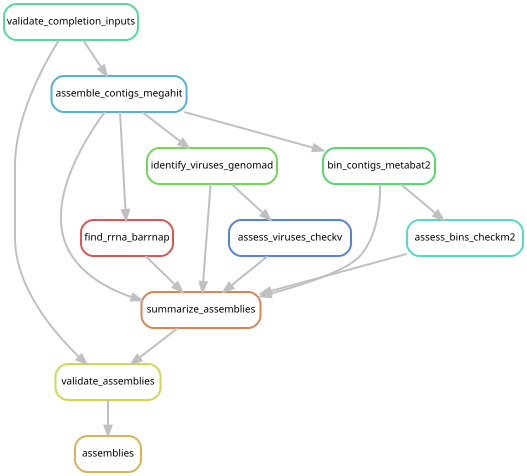
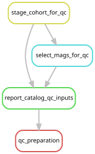

# Complete assembly for the expanded cohort

The policy requested on 2026-10-20 is to attempt assembly for every library
without a retained-read-count cutoff. A completed assembly with no contigs is
a valid result. Downstream genome and viral quality criteria still apply.
The old 175,000-pair setting and original membership remain as historical
execution records; they do not select inputs for this completion workflow.

The [completion manifest](../config/assembly_completion.tsv) selects ten original
libraries previously excluded by the cutoff and both newly host-depleted
*Halistemma rubrum* libraries. All use retained host-depleted FASTQs. The shared
rules run MEGAHIT, marker searches, geNomad, CheckV, MetaBAT2 and CheckM2. Mapping
for bin coverage stays within each library; the subsequent [full-cohort remapping](cohort_remapping.md) has now completed.

The [combined manifest](../config/post_expansion_samples.tsv) selects exactly
213 libraries: 193 reused original assemblies, 12 completion attempts, and eight
Bargmannia assemblies. New host-depleted Halistemma assemblies replace their
original full-read assemblies in this selection, preventing duplicate sample
and contig identifiers. Original products remain on disk.

All 12 completion assemblies finished successfully on 2026-10-20, producing
4,196 contigs totaling 8,607,764 bases. All 213 selected libraries now have
assemblies. One additional bin from YPM-IZ-111016 (145,748 retained pairs) passes
the initial CheckM2 screen; subsequent biological review is recorded in the
[completed catalog QC](catalog_qc.md).
The prepared review bundle contains 131 candidate bins, including the four
known eukaryotic controls, and 34,566 contigs. These counts precede domain review
and dereplication and are not a final MAG catalog.

## Run

From the repository root, activate the installed Snakemake 7.24.0 environment:

```bash
conda activate /gpfs/gibbs/project/dunn/cwd7/conda_envs/snakemake
export XDG_CACHE_HOME="$PWD/.cache"
```

Required inputs are the source manifests, completed mapping records, retained
FASTQs, and tools/databases named in `config/phase3_assembly.json`.
[Configuration](../config/assembly_completion.json) records all run roots.
Generate the frozen manifests with:

```bash
python scripts/assembly_completion.py plan
```

Dry run:

```bash
snakemake --snakefile workflow/assembly_completion.smk assemblies \
  --profile profiles/slurm --nolock --dry-run
```

Launch on Yale's YCGA partition:

```bash
mkdir -p logs
sbatch scripts/assembly_completion.sbatch
```

This bounded entry point has no trimming, host-depletion or full-cohort mapping
rules. Outputs and execution snapshots are under
`data/results/assembly_completion/2026-10-20/`; `stages/phase3_assembly.done`
must report PASS before combined-cohort preparation.



## Prepare the combined cohort for QC

This step stages links to selected products, verifies assembly checksums,
inventories future mapping reads, and extracts bins meeting existing CheckM2
screening criteria. These are **candidates for further QC**, not approved
prokaryotic genomes or mapping targets.

Dry run after assembly completion:

```bash
snakemake --snakefile workflow/post_expansion_preparation.smk qc_preparation \
  --cores 1 --nolock --dry-run
```

Launch:

```bash
sbatch scripts/post_expansion_preparation.sbatch
```

To queue this behind a running completion controller, add
`--dependency=afterok:JOB_ID` with its actual Slurm job ID. This entry point
consumes completed outputs and cannot rebuild missing upstream inputs.

Products under `data/results/post_expansion/2026-10-20/` include:

- `assembly_sources.tsv`: one selected assembly and checksum per library.
- `mapping_inputs.tsv`: all 213 read sources, counts, provenance and availability.
- `phase3_cohort/`: links to selected products and combined summary/membership.
- `qc/candidates/` and `qc/candidates.tsv`: CheckM2-screened bin sequences.
- `qc/contig_review.tsv`: contig lengths, GC content and pending domain-QC status.

The [candidate review table](../figures/catalog_qc/candidate_review.tsv) and
[preparation summary](../figures/catalog_qc/preparation_summary.json) retain
review status. Old taxonomy is included as context only for identical sequence
checksums. Four known Perkinsela-related bins remain excluded eukaryotic controls.

The completed mapping round regenerated full capped trimmed reads for 42
original libraries; their 25-million-pair assembly subsets are never
substituted. The other 171 libraries have retained mapping inputs (163
host-depleted and eight full capped Bargmannia inputs). Preparation inventories
these files without decompressing original FASTQs.



Preparation itself does not authorize mapping. The [MAG and viral QC review](catalog_qc.md)
subsequently passed, and the user explicitly authorized the
[213-library remapping round](cohort_remapping.md). The historical preparation
reports retain the hold that applied when they were created.
