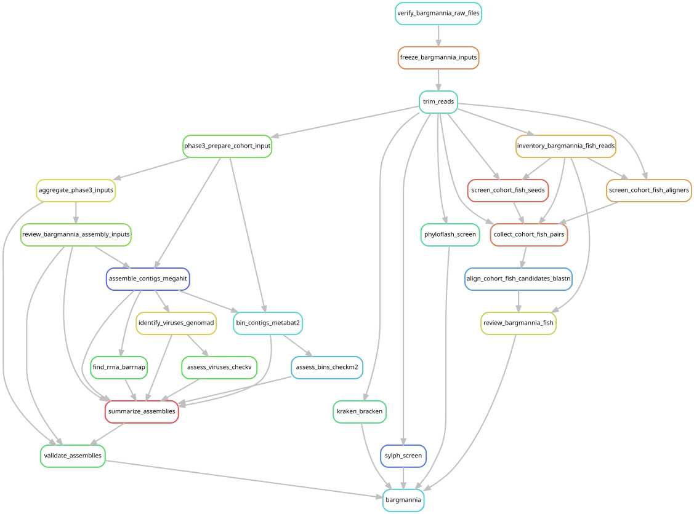

# Fourth study: Bargmannia

The new study is Mańko and colleagues (2026),
[doi:10.1093/zoolinnean/zlag150](https://doi.org/10.1093/zoolinnean/zlag150).
Only the eight Table S2 rows marked “This study” with new raw-read accessions
are selected. All eight became public at NCBI on 2026-10-19. Marker-only records,
previously analysed libraries and other local sequencing files are excluded.

| Collecting event | Published species | Public run |
| --- | --- | --- |
| D669-SS5 | Bargmannia amoena | SRR36270055 |
| T676-SS3 | Bargmannia elongata | SRR36270054 |
| M120-SS3 | Bargmannia elongata | SRR36270053 |
| D611-D6 | Bargmannia pyrosa | SRR36270052 |
| T411-SS2 | Bargmannia pyrosa | SRR36270051 |
| D666-D10 | Bargmannia stenotes | SRR36270050 |
| D961-D3 | Bargmannia profunda | SRR36270049 |
| D725-D8 | Bargmannia marlena | SRR36270048 |

The two new species are **Bargmannia marlena** and **Bargmannia pyrosa**.
The published names in Tables S1/S2 determine `species_current`; the NCBI label
is retained separately. Stable analysis identifiers use `Manko2026__` followed
by collecting event. Species and voucher corrections do not rename sequence files.
The [sample metadata](../data/metadata/manko2026/sample_metadata.tsv) includes
BioSamples, collecting events, tissues, preservation, coordinates, depths and
dates. Seven samples are siphosome tissue and T676-SS3 is a formalin-preserved
nectophore. Two unresolved S1/S2 voucher discrepancies remain explicit; no
conflicting voucher is promoted to an accepted identifier.

## Analysis and retained reads

This is a fourth study processed with the existing cohort methods. The
[workflow](../workflow/bargmannia.smk) imports the existing trimming, screening,
assembly, rRNA, viral recovery, binning and quality-assessment rules. Each local
raw file must match NCBI's original-upload MD5 before processing.

All eight libraries lack a host nuclear reference. Each uses up to 200 million
raw pairs, the established fastp settings, and the established seeded
25-million-pair assembly input. The workflow also runs Kraken2/Bracken, sylph,
phyloFlash and the same fish 12S screen used for the original cohort. Crustacean
screening remains paused. Quality-filtered full reads are **retained** for
subsequent competitive mapping; they are not temporary fish-screen inputs.

The full capped input is 1,451,481,136 pairs before quality filtering. Assembly
input eligibility is checked against the existing 175,000-pair minimum before
assembly. No original library is reprocessed by this entry point.

Use the existing environments and databases described in
[the main workflow guide](workflow/README.md). From the repository root:

```bash
# Refresh metadata only when deliberately reviewing a new public-source snapshot:
python3 scripts/bargmannia/prepare_metadata.py --download
# Preview; this never runs the original cohort's sequence analyses:
XDG_CACHE_HOME="$PWD/.cache" \
  /gpfs/gibbs/project/dunn/cwd7/conda_envs/snakemake/bin/snakemake \
  --snakefile workflow/bargmannia.smk --cores 16 --dry-run
mkdir -p logs/bargmannia
sbatch scripts/bargmannia/launch.sbatch
```

The launcher limits execution to four concurrent analysis jobs on YCGA, checks
the fish controls, and archives source and metadata. Results and retained reads
are under `data/results/bargmannia/2026-10-19/`. Original uploaded-file checksums
are recorded in [raw_files.tsv](../data/metadata/manko2026/raw_files.tsv).



## Combined-cohort follow-up

**Full-cohort mapping remains on hold pending assembly completion, additional
MAG/viral QC, catalog review and explicit authorization**, as requested on
2026-10-20. See [assembly completion](assembly_completion.md) and the
[QC plan](catalog_qc.md).
The hold is recorded in [post_expansion_remapping.json](../config/post_expansion_remapping.json).

Once both sets of per-library products pass review, combine the retained original
assemblies with the new Bargmannia and reviewed Halistemma assemblies, classify
and dereplicate the pooled genome and viral catalogs, and freeze the next catalog
version. Apply the MAGSP0026 domain
exclusion and review questionable domain assignments before accepting new bins.
After explicit authorization, perform one full remapping of all 213 libraries against the combined catalog and
regenerate the cohort summaries, treating Manko2026 as the fourth study.
Existing assemblies are reusable; existing mappings cannot establish abundance
against newly added competing targets. The original 205-library manuscript
tables remain the reporting scope until that combined analysis is complete.
