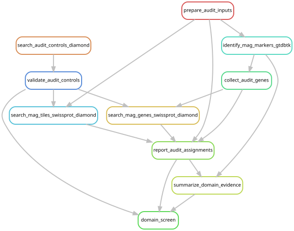
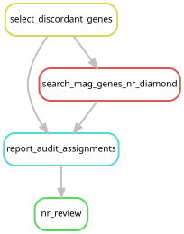
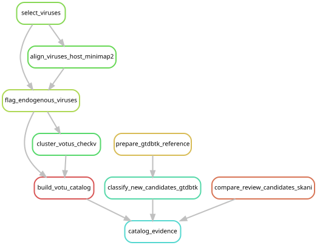
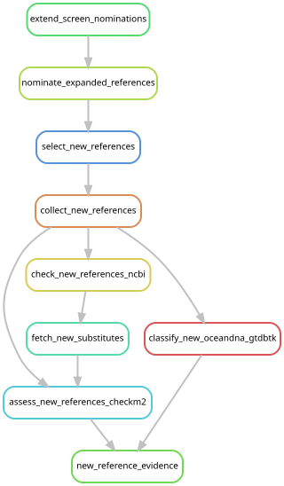
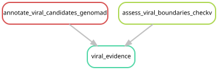
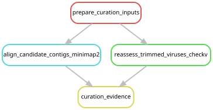
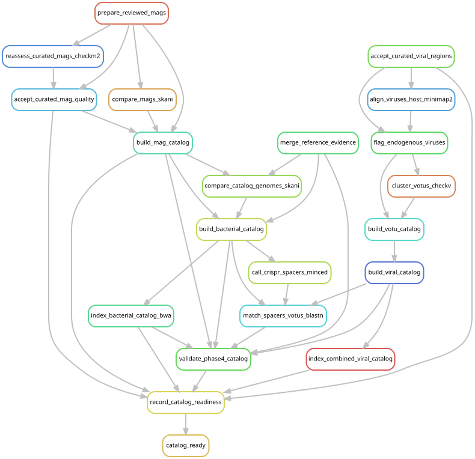

# Review candidate genomes before full-cohort mapping

The previous Thermoproteota assignment was a Perkinsela-related eukaryotic bin.
GTDB placement and CheckM2 estimates alone did not establish prokaryotic identity;
the [domain audit](mag_domain_audit.md) documents the evidence. Every prospective
MAG catalog member, including previously retained bins, was reviewed before
catalog v3 was frozen. The user subsequently authorized the
[213-library remapping round](cohort_remapping.md) on 2026-10-20. That round completed with PASS on 2026-10-21;
[current reporting](expanded_reporting.md) uses the reviewed v3 products.

[Preparation](assembly_completion.md#prepare-the-combined-cohort-for-qc) preserves
sequence identities and source assemblies. Known eukaryotic bins stay excluded
from the prokaryotic catalog and remain available as positive controls.

## Required evidence

1. **Identity and provenance:** link each candidate FASTA to its library and bin
   archive with checksums; verify unique contig IDs and distinguish replacement
   assemblies. Reuse old taxonomy only for identical sequences.
2. **Gene-domain evidence:** extend DIAMOND/Swiss-Prot searches to every candidate
   and use nr to adjudicate discordant evidence. Report bacterial, archaeal, eukaryotic, viral, ambiguous
   and unmatched genes. Retain database versions, controls and near-best-hit
   ties. Check translated DNA windows where prokaryotic gene prediction may
   miss eukaryotic genes. No hit does not establish prokaryotic identity.
3. **Contig consistency:** compare gene-domain evidence by contig with GC,
   coding density, coverage and length. Investigate mixed-domain bins,
   host-derived sequences and classifications supported by only a few contigs.
   GC differences alone do not justify removal.
4. **Marker support:** examine GTDB marker counts, alignment support, warnings
   and agreement with broader gene evidence. Conserved marker hits alone do
   not establish domain. Review every proposed archaeal assignment and conflict.
5. **Genome quality:** apply existing completeness and contamination criteria
   after establishing prokaryotic identity. Record retained, excluded and
   unresolved decisions with evidence, then dereplicate accepted genomes.
6. **Viruses and references:** review viral hallmarks, CheckV quality,
   host/endogenous-sequence evidence (including the new Halistemma reference),
   and nominated reference-genome identities and provenance.

Preparation labels gene-domain and contig-taxonomy QC as pending. Assembly
completion and candidate extraction do not complete these reviews. The final
review must produce per-candidate decisions and an immutable inventory of
approved mapping targets with sequence checksums and inclusion evidence.

No preparation workflow includes full-cohort mapping rules. Preparation could not clear the mapping hold. The explicit user authorization
recorded in `config/post_expansion_remapping.json` subsequently released it;
the authorized mapping round has now passed validation.

## October 20 review checkpoint

The completed broad screen covers all 131 candidates, using both predicted
proteins and translated DNA windows against the frozen Swiss-Prot database.
Fifteen domain controls passed. The
[review table](../figures/catalog_qc/domain_review.tsv) combines domain evidence,
marker counts, coding density and assembly coverage. It remains an evidence
table, not an approved catalog.

There are 104 bacterial-majority and 27 eukaryotic-majority candidates. The latter
include the four known Perkinsela-related controls, 20 previously unclassified
bins, and all three new Bargmannia candidates. New GTDB classification supports
the additional Physalia bin from YPM-IZ-111016 as Tyloplasma; the three new
Bargmannia bins have no bacterial or archaeal markers.

The nr follow-up contains 6,406 proteins across all 131 candidates: every
eukaryotic/archaeal Swiss-Prot assignment in a bacterial-majority candidate, all
genes on 15 contigs with at least three eukaryotic assignments exceeding their
bacterial assignments, and the 20 longest eukaryotic-hit proteins from each
eukaryotic-majority candidate. These counts select evidence for review; they are
not automatic exclusion thresholds. This supplementary nr search uses DIAMOND
`--sensitive`; the whole-candidate Swiss-Prot searches use `--very-sensitive`.
The original four-bin nr audit remains available separately.

Completed preparation also includes all three host-reference comparisons for
750 initially selected viral sequences, retained geNomad gene annotations and
CheckV boundary evidence, candidate genome ANI comparisons, and quality/taxonomy
assessment of 34 newly nominated references (22 GTDB and 12 OceanDNA). The eight
Bargmannia screen outputs enter the same nomination parser as the original 205
libraries; original nominations and reference QC are reused with provenance.
The negative-control reference pool remains fixed.

At this checkpoint, the remaining steps were to finish nr adjudication, resolve discordant
contigs, review the viral cellular flanks and hallmark evidence, combine old and
new reference QC, and curate/dereplicate the accepted sequences. Reference merge
requires compact bacterial and archaeal GTDB summary tables; the new full GTDB
output is retained under `phase4_catalog/references/new/gtdb/`. Final catalog
decisions, target checksums, and index preparation are described in the subsequent
curation section below. No full-cohort mapping has been started.

## Run and inspect the bounded workflows

From the repository root, use the Snakemake 7.24.0 environment described in the
[workflow guide](workflow/README.md#environment-and-inputs). The launchers below
capture source/configuration snapshots, logs and exit status. They are independent
entry points consuming the staged products; run the broad domain screen before
its nr follow-up. None imports cohort read-mapping rules.

| Purpose | Preview without executing | Cluster launcher |
| --- | --- | --- |
| All-candidate domain evidence | `snakemake domain_screen -s workflow/catalog_qc.smk --cores 1 --nolock --rerun-triggers mtime --dry-run` | `sbatch scripts/catalog_qc.sbatch` |
| nr adjudication | `snakemake nr_review -s workflow/catalog_nr_review.smk --cores 1 --nolock --rerun-triggers mtime --dry-run` | `sbatch scripts/catalog_nr_review.sbatch` |
| Viral catalog evidence and new-bin taxonomy | `snakemake catalog_evidence -s workflow/post_expansion_catalog.smk --cores 1 --nolock --rerun-triggers mtime --dry-run` | `sbatch scripts/post_expansion_catalog.sbatch` |
| New nominated reference QC | `snakemake new_reference_evidence -s workflow/expanded_references.smk --cores 1 --nolock --rerun-triggers mtime --dry-run` | `sbatch scripts/expanded_references.sbatch` |
| Viral genes and boundaries | `snakemake viral_evidence -s workflow/viral_catalog_qc.smk --cores 1 --nolock --rerun-triggers mtime --dry-run` | `sbatch scripts/viral_catalog_qc.sbatch` |

Broad-domain and nr outputs are in `data/results/catalog_qc/2026-10-20/`, with
execution records for completed broad-domain jobs 13633299/13633697 and nr
controller 13633804. Other outputs are in `data/results/post_expansion/2026-10-20/`,
with successful controller records 13633504 (catalog evidence), 13633990
(references) and 13634130 (viral genes/boundaries). Large sequence/search outputs
and execution archives are retained on the cluster outside Git.

The graphs below are generated from those exact targets and tracked configurations.
Their freshness is checked by the existing rule-graph CI job. Regenerate with
`./scripts/update_rulegraphs.py catalog_qc catalog_nr_review post_expansion_catalog expanded_references viral_catalog_qc`.











## Curated mapping targets

The nr follow-up finished successfully (controller 13633804). All 15 contigs
initially flagged by multiple eukaryotic Swiss-Prot assignments have predominantly
bacterial nr assignments. An isolated cross-domain match therefore does not
justify removing a contig. The four known false-archaeal bins remain excluded;
27 candidates in total lack supported prokaryotic genome identity. Their sequences
and evidence are preserved outside the prokaryotic catalog.

The follow-up compares all 17,626 contigs in the 104 bacterial candidates against
the three host references and the four excluded eukaryotic bins, with minimap2
`-x asm20 --secondary=no -c`. This is a comparison of assemblies; no library reads
are mapped. Alongside the protein-domain evidence, these comparisons identify
29 foreign fragments totaling 72,390 bp in 11 bacterial bins. Decisions and the
supporting measurements are retained in
[contig_decisions.tsv](../figures/catalog_qc/contig_decisions.tsv) and
[bin_decisions.tsv](../figures/catalog_qc/bin_decisions.tsv).

The recorded contig decisions remove broad nucleotide matches (at least half the
contig, at least 75% nucleotide identity) to host/eukaryotic references when
bacterial protein support is absent or limited to one Swiss-Prot gene/window
and nr supplies no bacterial assignment. They also remove fragments with
eukaryotic protein and translated-window evidence, no bacterial gene/window/nr
assignment, and either two eukaryotic nr assignments or one spanning at least
150 amino acids. These are curation criteria for assembled fragments, not
read-presence thresholds. Short isolated matches and matches within a supported
bacterial gene context remain annotated in the review table rather than forcing
an exclusion. Unmatched sequence alone does not establish its origin.

The 11 edited bins were reassessed with CheckM2; all 104 candidates pass the
existing quality thresholds after curation. Original placements are carried
forward only from the checksum-verified source bins; edits are confined to the
documented fragments. The
[updated quality table](../figures/catalog_qc/curated_mag_quality.tsv) records the
new measurements and sequence checksums. There are **32 MAG clusters**: the 31
remaining after the false-archaeal correction and the new Tyloplasma MAG from
YPM-IZ-111016, assigned **MAGSP0033**. Retired MAGSP0026 is not reused.

CheckV found cellular flanks on 22 initially included viral candidates. Viral
intervals were extracted with one-based inclusive coordinates; separate viral
intervals on the same contig were kept as separate sequences. A second CheckV
run on all 751 resulting regions found no remaining cellular flanks. One short,
low-completeness region and one region lacking a retained hallmark fail the
existing inclusion rule, leaving **749 viral regions** before clustering. The
[region decision table](../figures/catalog_qc/viral_region_decisions.tsv) preserves
the original sequence, interval, retained hallmarks, CheckV results and decision.
Candidates with geNomad hallmark evidence but no CheckV viral-gene match remain
explicitly identifiable in this table; a CheckV no-hit alone is not an exclusion.
CheckV's [documented contamination workflow](https://pypi.org/project/checkv/)
supports removing cellular flanks before downstream analysis; geNomad's
[gene annotation output](https://portal.nersc.gov/genomad/pipeline.html) supplies
the hallmark annotations.

Full old/new reference evidence is merged with checksum-verified genome sequences.
The finalization workflow reuses the existing MAG/reference/vOTU clustering,
host-alignment, CRISPR and index rules. Optional historical catalogs carry
identifiers forward by shared membership; new clusters receive identifiers
beyond the previous maximum, leaving retired identifiers unused. Splits and
merges are recorded in the final ID crosswalk. The original catalogs and mappings
are unchanged.

The pooled microbial catalog contains **478 targets**: 24 MAG representatives
and 454 public reference genomes, plus 20 unchanged decoys. All 32 MAG clusters
are accounted for; eight are represented by higher-scoring public genomes in
the pooled catalog. Relative to the previous 448-target catalog, the false
archaeal target BAC00006 is retired, the new Tyloplasma MAG enters as BAC00459,
and the number of public reference representatives increases by 30. Existing
MAG cluster identifiers are preserved, including for bins with fragments removed.

The viral regions form **407 associate-virus clusters** and **157 endogenous
candidate clusters**. Six CRISPR host links remain after curation. These are
catalog membership and sequence-linkage results. The subsequent expanded
read mapping is complete; [current reporting](expanded_reporting.md) derives
prevalence and coverage summaries from it.

### Reconstruct the pre-mapping catalog checkpoint

The commands below document the completed October 20 freeze. Its readiness
recorder requires the mapping hold that was in force then. The active
configuration now records authorization, so it intentionally cannot recreate
that pre-authorization receipt. Preserve the existing receipt and inventory;
the current [mapping preflight](cohort_remapping.md) checks their sequence
identities. Reconstructing the historical freeze requires a separate checkout
with the configuration preserved in
`data/results/post_expansion/2026-10-20/executions/13644738/source.tar.gz`,
the configured environment and staged evidence. From that repository root:

```bash
# Assembly comparisons and viral-boundary recheck; no read mapping.
snakemake curation_evidence -s workflow/catalog_curation.smk --cores 1 --nolock --rerun-triggers mtime --dry-run
sbatch scripts/catalog_curation.sbatch

# Reproduce the recorded contig/bin decisions from that completed evidence.
python3 scripts/review_catalog_contigs.py

# Pool, dereplicate, index and validate the catalogs, stopping before mapping.
snakemake catalog_ready -s workflow/catalog_freeze.smk --cores 1 --nolock --rerun-triggers mtime --dry-run
sbatch scripts/catalog_freeze.sbatch
```

The curation run 13644496 completed the protein-informed inputs, viral recheck
and three sequence comparisons; the Halistemma comparison exceeded its 32 GB
allocation and succeeded with 64 GB in recovery 13644570. Reference merge
13644515 and edited-bin CheckM2/acceptance 13644695 completed successfully.
Final catalog construction and indexing completed under controller 13644738;
the catalog validator passed with zero errors. Report-only refresh 13645110
separates the 49 clustered public references from the eight MAG clusters
represented by references; it reran validation and checksum reporting only.
The launchers
capture sources, environment configuration, logs and exit status under
`data/results/post_expansion/2026-10-20/executions/`.

Catalog files and indexes are in
`data/results/post_expansion/2026-10-20/curated/phase4_catalog/v3/`.
The final [readiness report](../figures/catalog_qc/catalog_v3/catalog_ready.json),
[file checksum inventory](../figures/catalog_qc/catalog_v3/inventory.tsv),
[ID crosswalk](../figures/catalog_qc/catalog_v3/catalog_id_crosswalk.tsv) and
[compact catalog tables](../figures/catalog_qc/catalog_v3/README.md) are in
`figures/catalog_qc/catalog_v3/`. At the freeze checkpoint, readiness required
the catalog validator to pass, all indexes to exist, and the explicit mapping
hold to remain set. That receipt did not authorize or submit mapping.

The retained read inventory is
`data/results/post_expansion/2026-10-20/mapping_inputs.tsv`: 163 libraries have
host-depleted reads and eight Bargmannia libraries had full trimmed reads.
The 42 original reference-free libraries required trimmed reads to be regenerated;
that regeneration and all input checks completed in the authorized mapping round.
A 25-million-pair assembly subset was not substituted for the full mapping input.
Mapping was held for both catalogs at the preparation checkpoint; subsequent
[explicit authorization](cohort_remapping.md) released the combined round.





Regenerate these graphs with
`./scripts/update_rulegraphs.py catalog_curation catalog_freeze`.

### Viral versus MAG mapping

The existing Phase 5 workflow runs two competitive alignments per library:
one against the pooled bacterial/archaeal catalog (MAGs, public references and
decoys), and one against the combined viral catalog. Associate and endogenous
candidate viral targets compete within the viral alignment. Coverage is reported
separately for microbial genomes and viral clusters. CRISPR spacer matches are
a separate genome-to-virus linkage analysis. Both catalogs were prepared before
the single completed cohort-remapping round and were mapped in that round.
