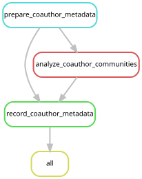

# Tissue, depth and matched geographic comparisons

This analysis joins the reviewed specimen metadata to the completed 213-library
microbial, viral and eukaryote evidence tables. It uses existing mapping-input
counts for sequencing effort and the completed fish 12S screen for potential
prey. Fish read-pair counts and screening denominators remain separate from
genome-target counts. It does not read FASTQs, change a catalog or map sequences.

## Questions and design

The principal questions are whether detected bacterial communities differ among
regions within *Physalia utriculus*, and among *Physalia* species within the
southwestern Pacific. Both comparisons use tentacle samples, holding tissue
constant; all specimens in these comparisons are from Church2025 and have a
collection-depth value of zero. The analyses therefore do not need redundant
study or depth covariates. We do not analyse life stages.

All 213 libraries have numeric collection depths; two have unknown tissues.
The specimen table preserves recorded intervals, derived midpoints and the
WS6 collecting-event mean. It also identifies the 150 Physalia depths assigned
as zero. The depth figure shows non-Physalia specimens and their recorded
intervals, without treating the assigned Physalia depths as measurements.

Tissue comparisons are strongly constrained by sampling. Among Physalia there
are 142 tentacle samples, three whole bodies, three zooids, one corm and two
unknown tissues. The other siphonophores comprise 61 siphosomes and one
nectophore. The nectophore is the formalin-preserved Bargmannia specimen with
elevated background-control detections. A tissue effect cannot be separated
from these other differences by pooling the specimens.

The most closely matched tissue comparison is between whole-body and tentacle
samples of Central-Pacific *P. utriculus*. Nineteen of twenty libraries satisfy
the existing single-physical-flowcell policy. There are only twelve distinct
ways to rearrange tissue labels within their flowcells, insufficient for a
test at the 0.05 level. Tissue results remain descriptive, retaining all
libraries and non-detections in their denominators.

Depth and geography are also coupled. All seven California *N. septata*
specimens were collected at 217–662.29 m, whereas the three Washington specimens
were collected within 0–20 m. Only three satisfy the single-flowcell policy.
The DT-68 pattern can be described, but cannot establish an independent depth
effect. Most other species have only one or two specimens. The per-host design
table records the available depth variation and replication.

## Conditional community tests

Settings and exact subsets are in
[coauthor_metadata_analysis.json](../config/coauthor_metadata_analysis.json).
These are post hoc tests prompted by coauthor feedback; they are separate from
the original pre-specified Phase-6 analyses.

- The Pacific *P. utriculus* contrast selects 44 tentacle samples from the
  Central, northwestern and southwestern Pacific; 42 are eligible for inference.
- The southwestern-Pacific species contrast selects 47 tentacle samples of
  *P. megalista*, *P. minuta* and *P. utriculus*; 33 are eligible for inference.
- A broader *P. utriculus* contrast also includes the western Indian Ocean.
  After removing empty profiles, this group can be completely confounded with
  flowcell. The workflow checks rank and reports an untestable result instead
  of silently estimating a partial geographic contrast. Eastern-Indian samples
  all span multiple flowcells; the southwestern Atlantic has one specimen.
  All regions remain in the descriptive table.

Bacterial profiles contain accepted genome targets. Empty profiles remain in
incidence summaries, but are omitted from community-distance tests because
binary Jaccard distance between two empty profiles is undefined. Each test
reports eligible, included and excluded counts.

The model is binary Jaccard distance ~ log10(actual mapping input pairs) +
physical flowcell + contrast group. The group is tested marginally, using
9,999 permutations restricted within flowcell. Thus read effort and flowcell
enter the adjustment explicitly. A full-rank group contrast and at least
twenty distinct blocked group-label allocations are required. The workflow
also reports a blocked test of multivariate dispersion using square-root
Jaccard distances to avoid negative squared distances. Benjamini–Hochberg
adjustment covers the estimable comparisons within each breadth threshold.
The primary bacterial presence rule is unchanged, with the existing 5% and
20% breadth alternatives reported as sensitivity analyses.

Non-detection does not establish biological absence. These profiles describe
detected catalog targets under the sampling and sequencing procedures, not
the complete microbiome. Geographic and host associations remain observational;
collection date, preservation and finer-scale locality may also differ.

A separate [C. acnes omission sensitivity](cutibacterium_sensitivity.md) repeats
the two estimable primary contrasts without reference BAC00019, preserving these
outputs. The southwestern-Pacific host contrast remains supported after this
exclusion.

## Host-reference context

The current host-depletion table supplies per-species removal percentages for
all 163 reference-mapped libraries. Percentages are recomputed from the recorded
input and retained read counts, then summarized as a median and range across
specimens. The three reference groups are also summarized together: Physalia,
*N. septata* and *H. rubrum*. These describe read processing; differences among
species do not isolate the effect of reference availability on genome recovery.

The historical paired comparison uses the original ten-library subset and fixed
v2 catalogs: five Physalia and five *N. septata* libraries, each mapped with
host-depleted and full trimmed reads. Summaries retain the shared and
route-specific genome–library detections. Viral counts include both associate
and endogenous-candidate targets in that historical catalog. These counts are
not relabelled as v3 results or as current associate-virus detections.

## Reproduction and outputs

Use the existing Snakemake 7.24.0 and R statistics environments. From the
repository root, in a compute allocation:

```bash
export XDG_CACHE_HOME="$PWD/.cache"
snakemake -s workflow/coauthor_metadata.smk all --cores 1 --dry-run --rerun-triggers mtime
snakemake -s workflow/coauthor_metadata.smk all --cores 1 --rerun-triggers mtime --printshellcmds
```

This bounded entry point has three producing rules and cannot schedule sequence
analyses. Missing completed evidence is an error. The canonical source tables
are the same ones used by the collection-context summaries; the current
publication species identifications are joined afresh.



Generate or check the diagram using `scripts/update_rulegraphs.py
coauthor_metadata` or the same command with `--check`. Existing graph CI checks
this entry along with the other workflow graphs.

Outputs are under [figures/coauthor_metadata](../figures/coauthor_metadata/):

- `specimen_context.tsv`: all specimens with tissue, depth, actual mapping
  effort, flowcell eligibility and accepted detection counts.
- `tissue_incidence.tsv`, `depth_incidence.tsv`, `host_locality_incidence.tsv`
  and `host_depth_design.tsv`: denominators, detection counts and design limits.
- `targeted_incidence.tsv`: same-host regional and same-region host summaries,
  including all-library and eligible-only denominators.
- `contrast_membership.tsv` and `community_membership.tsv`: exact samples in
  each contrast, including empty-profile exclusions at each threshold.
- `community_tests.tsv`, `dispersion_tests.tsv`, `community_values.json` and
  `descriptive_values.json`: statistical results and machine-readable values
  for manuscript use.
- `host_depletion_summary.tsv`, `historical_host_concordance.tsv` and
  `host_reference_values.json`: current per-species removal summaries and the
  separate historical fixed-catalog paired comparison.
- `values.tex`: automatically generated manuscript macros for the matched
  contrasts, fish/tissue counts and host-reference summaries. Percentages have
  no percent sign so they can be formatted consistently in manuscript prose.
- `depth_patterns.pdf` and `targeted_incidence.pdf`, with PNG previews: depth
  patterns and matched regional/host incidence. Genome-target and eukaryote
  reporting-group counts have different units and are shown separately.
- `provenance.json`, `provenance/source/` and `session_info.txt`: completed
  input/output/source hashes, source snapshot and actual software versions.

The final execution and verification assessment is recorded in
[dev_docs/coauthor-metadata-analysis.md](../dev_docs/coauthor-metadata-analysis.md).
