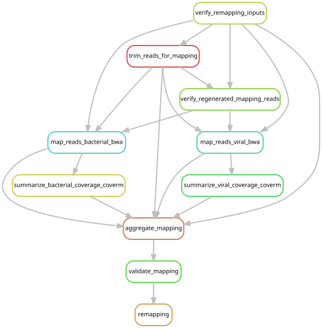

# Map the expanded cohort to catalog v3

**Complete (2026-10-21):** controller **13646027** finished at 14:12 EDT after
939/939 steps (15:48:56 elapsed). The final validator reports PASS for all 213
libraries, 498 microbial targets including decoys, 564 viral targets and all 42
regenerated-read checks, with zero errors. Downstream work is tracked in the
[current reporting guide](expanded_reporting.md).

The user authorized this round on 2026-10-20 after the
[catalog review](catalog_qc.md#curated-mapping-targets). The authorization in
[post_expansion_remapping.json](../config/post_expansion_remapping.json) identifies
the exact catalog record, checksum inventory, read-source inventory and mapping
policy. Earlier preparation reports retain the hold that applied when they were
created; this authorization supersedes that hold for this mapping round.

All **213 libraries** enter two competitive alignments: one against the 478
microbial targets plus 20 decoys, and one against 564 viral targets. The mapping
catalog initially classified these as 407 associates and 157 endogenous candidates;
[reviewed reporting](viral_reporting_review.md) assigns 404 and 160, respectively,
without changing the competing sequences or mappings. The bounded workflow imports the existing
Phase-5 mapping and CoverM rules, with the same alignment, duplicate-removal and
coverage settings in [phase5_mapping.json](../config/phase5_mapping.json).
It consumes completed v3 indexes and does not import assembly, host-depletion,
catalog-construction, or downstream presence-analysis rules.

| Input source | Libraries | Handling |
| --- | ---: | --- |
| Host-depleted Physalia | 151 | All retained pairs |
| Host-depleted Nanomia septata | 10 | All retained pairs |
| Host-depleted Halistemma rubrum | 2 | All retained pairs |
| Retained full trimmed Bargmannia reads | 8 | Reuse completed trimming |
| Original libraries without a host reference | 42 | Regenerate full capped trimmed reads |

The [frozen input inventory](../config/post_expansion_mapping_inputs.tsv) records
paths, counts, sources and provenance hashes. Full reads use the established
200-million-pair cap, seed 20260829 and fastp settings. Both alignments consume
the same read set for each library. A 25-million-pair assembly subset is never
used for mapping. Newly regenerated trimmed files are temporary and are removed
only after both alignments and the read-input check finish. Previously retained
read files remain available.

The preflight verifies every catalog/index checksum, all read-producer records,
current retained-file sizes, host-depletion counts, raw lane order and current
raw-file sizes. It does not decompress the retained inputs. Regenerated libraries
must additionally match their original raw-file hashes, software, cap/seed and
paired-read count before either alignment starts. The final validator checks
complete library-by-target coverage tables and read-count accounting. Read-source
labels distinguish retained trimmed reads from regenerated trimmed reads.

## Preview and launch

Use the Snakemake 7.24.0 environment from the [workflow guide](workflow/README.md#environment-and-inputs),
from the repository root:

```bash
snakemake remapping -s workflow/cohort_remapping.smk --cores 1 --nolock --rerun-triggers mtime --dry-run
sbatch scripts/cohort_remapping.sbatch
```

The launcher allows up to 16 simultaneous jobs and 256 allocated cores on YCGA,
with one exact-capping job at a time. The existing Slurm submit helper waits when
the cluster's hourly submission limit is reached. Source snapshots, configuration,
the Git revision, logs and exit status are recorded for each controller execution.

The initial preflight completed successfully under controller **13645653**.
The initial dry run contained 213 microbial alignments, 213 viral alignments,
42 trimming jobs, 42 regenerated-input checks, 426 coverage summaries, aggregation
and validation. No assembly or catalog-building jobs were scheduled.



Generate or check this graph with
`./scripts/update_rulegraphs.py cohort_remapping` or
`./scripts/update_rulegraphs.py cohort_remapping --check`.

## Outputs and completion

The run root is `data/results/post_expansion/2026-10-20/remapping/`:

- `preflight.json`: authorization and input/catalog checks.
- `executions/<job_id>/`: source snapshots and controller records.
- `phase5_mapping/v3/bam/`: filtered, deduplicated alignments and indexes.
- `phase5_mapping/v3/cohort/`: `bacterial_coverage.tsv`, `viral_coverage.tsv`
  and `library_mapping.tsv`.
- `stages/phase5_mapping_cohort_v3.done`: final PASS/FAIL accounting.

These results are kept separately from earlier mappings. The completed
[reporting workflows](expanded_reporting.md) use them for the current manuscript
and S1 Appendix.
