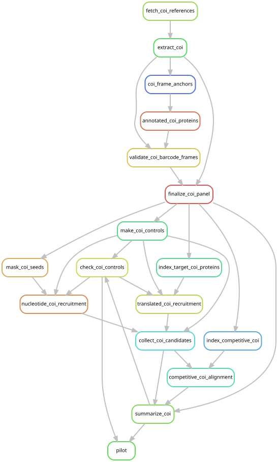
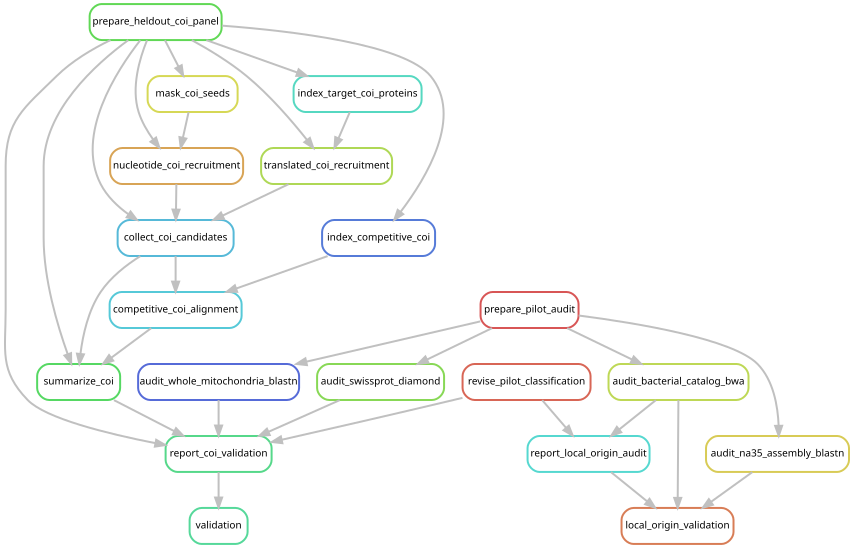
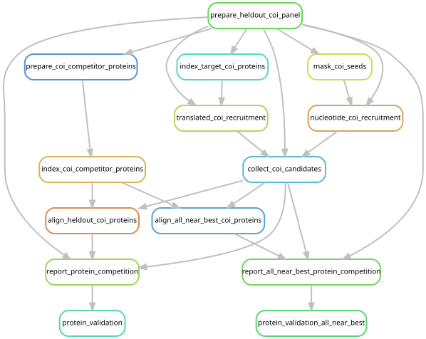
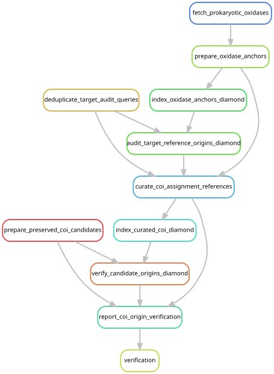

# Crustacean COI pilot

## Paused investigation

Crustacean screening was paused at Casey's request on 2026-10-18 and is preserved
on branch `crustacean-coi-screen`. The cohort job was cancelled; do not interpret
partial outputs as a completed screen. See the [pause and resumption
record](../dev_docs/crustacean-coi/verification.md#paused-on-a-separate-branch-2026-10-18).

This analysis tests whether COI searches recover crustacean sequences in
host-depleted *Nanomia septata* libraries. It compares exact nucleotide seeds
with translated protein searches on the same read pairs. It is separate from the
accepted manuscript analyses and does not change their inputs or identifiers.

## Inputs and references

[The pilot manifest](../config/crustacean_coi_pilot.tsv) includes all ten
*N. septata* libraries and every retained host-depleted pair: 2,152,939 pairs in
total, with no additional subsampling. These are the existing
`data/results/phase3_cohort/inputs/{sample}_R[12].fastq.gz` files. They retain pairs
with both mates unmapped to the host after quality filtering and the original
200-million-pair input cap. Neither host mapping nor earlier analyses are rerun.
The [broader screening plan](prey_marker_screen.md) defines the staged expansion.

The [download specification](../config/crustacean_coi_sources.json) includes
[MetaZooGene](https://metazoogene.org/atlas/) COI barcodes for copepods, krill,
decapods, amphipods, mysids, lophogastrids and ostracods. Annotated COI sequences
from the [RefSeq mitochondrial release](https://ftp.ncbi.nlm.nih.gov/refseq/release/mitochondrion/)
extend coverage across the gene. Other RefSeq COI sequences and MetaZooGene
cnidarian COI barcodes provide competitors during nucleotide identification.
Downloaded URLs, dates, HTTP headers and SHA-256 hashes are recorded in
`data/results/crustacean_coi/reference/2026-10-17/downloads.json`.

Source headers are retained in the reference metadata. The downloaded MetaZooGene
FASTA headers identify `MZGdb_v2025-m10-01`; the website's newer database label is
not treated as the version of these files. Barcodes can occupy different reading
frames and orientations: DIAMOND against annotated crustacean COI proteins identifies their
frames, followed by translation with invertebrate mitochondrial code 5. Accepted
barcodes require at least 50 aligned amino acids, 50% protein identity, 80% query
coverage and no internal stop codon. Only unambiguous sequences of 180–2,400 nt
enter this pilot panel. Exclusions and group coverage are tabulated.

## Search and interpretation

1. BBDuk recruits pairs with an exact 25-base match on either strand to the
   DUST-masked target COI panel. Both mates are retained.
2. DIAMOND searches each mate in translation using code 5, sensitive mode,
   minimum ORF length 20, at least 60% query coverage and E-value at most 0.001.
   The protein panel contains the same target records as the nucleotide panel.
3. Both mates of the union of candidates are aligned with BLASTN against the
   target and competitor COI sequences. The extraction checks pair synchronization
   and the expected input count.
4. Rank all competitive alignments by bit score before applying the evidence
   thresholds. Provisional classification requires at least 90 aligned
   nucleotides and 80% identity among references within 1% of the best score.
   Target/non-target ties and discordant mates are ambiguous. A result list
   truncated while scores are still near-best is also ambiguous.

A stronger divergent match cannot be discarded in favor of a weaker match
that happens to pass the identity cutoff. This corrects the initial pilot
reporting rule. The original reports are preserved; the validation below writes
revised reports separately without scanning the libraries again.

These are pilot comparison criteria, not a validated species-identification or
prey-presence threshold. A COI match does not by itself establish predation.
Performance depends on reference coverage and read depth;
an absent pilot match does not establish absence from the specimen.

Twelve paired synthetic controls exercise exact and reverse-complement recovery,
synonymous substitutions, siphonophore host sequences, fish/insect COI, random
sequence and low complexity. Real-read processing depends on these checks passing.
Per-library `summary.json`, `classified_pairs.tsv` and benchmark files report
method overlap, competitive assignments and runtime separately.

## Environment and execution

The existing McCleary environments supply Python 3.11, Biopython 1.81, Snakemake
7.24.0 and BBTools 39.01. The launcher loads BLAST+ 2.15.0; DIAMOND 2.1.24 and
SeqKit 2.8.0 (installed under module label 2.8.1) are selected by absolute paths.
Paths and dated output roots are in [the configuration](../config/crustacean_coi.json).
For another installation, rebuild these dependencies with conda-forge/bioconda
and update those paths before running.

From the repository root:

```bash
export PATH=/gpfs/gibbs/project/dunn/cwd7/conda_envs/snakemake/bin:$PATH
export XDG_CACHE_HOME="$PWD/.cache"

# Preview the isolated workflow only.
snakemake --snakefile workflow/crustacean_coi.smk pilot \
  --cores 8 --dry-run --rerun-triggers mtime

# Run references, controls and all ten complete retained libraries on YCGA.
mkdir -p logs/crustacean_coi
sbatch scripts/crustacean_coi/batch.sh pilot

# Optional smaller scopes use the same rules.
sbatch scripts/crustacean_coi/batch.sh references
sbatch scripts/crustacean_coi/batch.sh controls
```

Run only one scope at a time against these output directories. Existing successful
products are reused. Logs and execution-specific source snapshots, input file
statistics, versions, exit status, commands and report copies are retained under
`data/results/crustacean_coi/executions/{SLURM_JOB_ID}/`.
Bulk reference and read files remain outside Git.



This graph is generated from `workflow/crustacean_coi.smk`, target `pilot`; repeated
sample/mate jobs collapse into one node per rule. It does not invoke the main
analysis workflow. Controls and real libraries use the same search rules, so
collapsing them creates an apparent loop at the control gate; the actual jobs
form an acyclic dependency graph. Generate/check it without running any analysis:

```bash
./scripts/update_rulegraphs.py crustacean_coi
./scripts/update_rulegraphs.py crustacean_coi --check
```

The existing rule-graph CI check covers this entry. Detailed execution history is
in [the pilot run notes](../dev_docs/crustacean-coi/pilot.md).

## Reference-divergence validation and candidate audit

The validation uses the same recruitment and competitive alignment rules as the
pilot. It withholds up to five genera per crustacean group, selected from
annotated RefSeq COI, and removes every panel record whose species label mentions
one of those genera (including original names), plus identical full sequences.
Five 300-nt fragments per selected reference generate paired 150-nt reads.
Source labels are not independently reconciled taxonomy. These error-free
controls test reference divergence; they do not measure detection probability
at a particular prey abundance. Recruitment and final assignment are reported
separately, with the original host, fish, insect, random and low-complexity negatives.

All real pilot candidates are also searched against whole mitochondrial genomes
and the existing reviewed-protein database. Two suspicious NA35 pairs and their
four barcode references receive an additional broad nr protein search. The local
Swiss-Prot and nr databases date to November 2023; their results can identify
alternative homologs but do not constitute an exhaustive current database search.

```bash
snakemake validation --snakefile workflow/crustacean_coi_validation.smk \
  --cores 8 --dry-run --rerun-triggers mtime
sbatch scripts/crustacean_coi/batch_validation.sh
# After the audit query file exists, run the focused broader protein check.
sbatch scripts/crustacean_coi/batch_nr_audit.sh
```

The [validation configuration](../config/crustacean_coi_validation.json) consumes
the completed reference and pilot products. It has no rules that rebuild those
inputs or invoke the original analysis workflow. Outputs are under
`data/results/crustacean_coi/validation/2026-10-17/`, with separate `reclassified/`,
`heldout/`, `audit/` and `nr_fast_audit/` directories. Choose a new output root for a
new validation experiment; the focused nr launcher refuses to overwrite its result.
It uses fast mode to look for close alternative homologs; an absent match in this
check is not evidence that a divergent homolog is absent.

An additional `protein_validation` target compares protein-level competitive
assignment on the same held-out controls. Run it with
`sbatch scripts/crustacean_coi/batch_validation.sh protein_validation`. Its
`protein_competition/` outputs compare 60%, 70% and 80% amino-acid identity cutoffs
while retaining near-best competitors. This is a diagnostic comparison, not an
independently validated production cutoff. A second target,
`protein_validation_all_near_best`, uses DIAMOND `--top 1` to retain all reported
alignments within 1% of the best score instead of a 200-hit list. Launch it with
`sbatch scripts/crustacean_coi/batch_validation.sh protein_validation_all_near_best`.
Only this explicitly uncapped output disables the truncated-list ambiguity check.
See the
[validation findings](../dev_docs/crustacean-coi/validation.md).



Generate/check this validation graph with `scripts/update_rulegraphs.py coi_validation`.
It describes the `validation` and `local_origin_validation` targets; the optional focused nr search is the
single additional search command in `batch_nr_audit.sh`.



This graph covers both `protein_validation` and `protein_validation_all_near_best`;
regenerate it with `scripts/update_rulegraphs.py coi_protein_validation`.

The local-origin audit reuses the existing bacterial catalog index and NA35
assembly with `sbatch scripts/crustacean_coi/batch_validation.sh local_origin_validation`.
It writes new candidate alignments and explicit audited labels; it does not rerun
catalog construction, assembly, or whole-library mapping.

## Verification with prokaryotic competitors

`workflow/crustacean_coi_verification.smk` audits all target COI proteins against
annotated RefSeq mitochondrial COI and 42,947 bacterial/archaeal oxidases from
UniProt release 2026_03. The
[query and thresholds](../config/crustacean_coi_verification.json) are explicit.
The download includes Pfam PF00115 proteins and additional oxidases retrieved by
gene/product names. Its TSV, release headers, query, retrieval date and hash are
preserved under `data/results/crustacean_coi/verification/2026-10-18/source/`.
This is a broad oxidase competitor set, not all bacterial proteins.
Identical target protein sequences are audited once and linked back to every
source record: 108,778 records reduce to 21,447 distinct protein sequences.

Annotated mitochondrial proteins provide the reference origins for this audit;
MetaZooGene barcodes cannot validate their own taxonomic labels. A target barcode
is quarantined from assignment if a prokaryotic or other eukaryotic anchor falls
within 5% of its best score, or no suitable crustacean anchor is found. The four
independently flagged barcodes are also quarantined. Quarantine means that the
label is unsuitable for this assignment procedure, not that every quarantined
record is demonstrably contaminated. Reference sequences and audit evidence are
retained. NCBI lineages also correct crustaceans outside the original seven
groups that the initial panel called non-targets.

The original broad recruitment panel remains unchanged. Verification reuses the
92 recovered real pairs and the original and held-out control candidates; it
does not scan libraries again. DIAMOND compares their translations under codes
1 and 5 with curated mitochondrial and prokaryotic proteins. All reported hits
within 5% of the best score are retained, with no fixed hit-count limit. The
held-out comparison excludes the same reference genera as the earlier benchmark.

A supported eukaryotic call requires agreement in the same mate between protein
evidence (at least 80% identity, 40 amino acids and 80% query coverage) and
nucleotide evidence (at least 90% identity and 120 nucleotides). Strong exclusive
prokaryotic protein matches identify bacterial/archaeal oxidase candidates.
Conflicting matches remain ambiguous; weaker evidence remains unresolved.
These conservative criteria are provisional, not universal taxonomic cutoffs.
Every recruited pair remains in the output, including ambiguous candidates.

```bash
snakemake verification --snakefile workflow/crustacean_coi_verification.smk \
  --cores 8 --dry-run --rerun-triggers mtime
sbatch scripts/crustacean_coi/batch_verification.sh
```

The workflow writes `classified_pairs.tsv`, `summary.json` and `gate.json` under
the verification root. Its checks require retention of all divergent positive
controls, no supported crustacean calls among negatives, recognition of both
known bacterial pairs, and quarantine of all four flagged barcodes. A completed
workflow does not imply a passed scientific gate: inspect `gate.json` before
expanding the survey. Execution records retain the source snapshot, input hashes,
versions, commands, exit status and output hashes.



Generate/check this graph with `scripts/update_rulegraphs.py coi_verification`.
