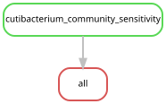

# Community sensitivity to the C. acnes reference

The [human/Cutibacterium comparison](human_cutibacterium.md) motivated one
additional check of the two estimable primary community contrasts. This check
omits *C. acnes* reference BAC00019 from bacterial profiles. It preserves the
original cohort definitions, tentacle restriction, 10% breadth presence rule,
read-effort and flowcell adjustment, permutation number and seed. Specimens
are not removed according to their human-read counts. The main analysis outputs
remain unchanged.

Before the omission, the workflow reconstructs both original primary tests and
requires matching included/excluded counts, model degrees of freedom, R-squared,
pseudo-F and P values. It then repeats the tests without BAC00019, reports
within-flowcell dispersion diagnostics, and applies Benjamini–Hochberg correction
across the two sensitivity contrasts. Empty community profiles are handled as in
the original analysis. Their specimen membership is exported explicitly.

Omitting BAC00019 leaves both contrast memberships unchanged. In the southwestern
Pacific, the host-species contrast retains 30 specimens and explains 13.3% of
variation (P = 0.0001, q = 0.0002). The regional contrast within *P. utriculus*
retains 32 specimens and explains 7.1% (P = q = 0.1539). Thus the host-associated
community difference is retained when this skin-associated target is excluded.
This check does not establish that other detected organisms are free from
contamination, or identify the source of *C. acnes* DNA.

Run from the repository root in a compute allocation:

```bash
export XDG_CACHE_HOME="$PWD/.cache"
snakemake -s workflow/cutibacterium_sensitivity.smk all --cores 1 --dry-run --rerun-triggers mtime
snakemake -s workflow/cutibacterium_sensitivity.smk all --cores 1 --rerun-triggers mtime
```

The entry point reads completed tables only. Settings are in
[cutibacterium_sensitivity.json](../config/cutibacterium_sensitivity.json).
Outputs in [figures/cutibacterium_sensitivity](../figures/cutibacterium_sensitivity/)
include `community_tests.tsv`, `community_membership.tsv`, `summary.json`,
`values.tex`, R session information and provenance. Source snapshots, checksums
and the actual commands identify the executed analysis. Input and source hashes
are checked before and after computation.



Generate or check the diagram with `scripts/update_rulegraphs.py
cutibacterium_sensitivity` or the same command with `--check`.
