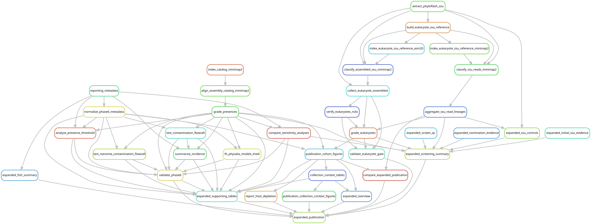

# Current cohort and downstream reporting

The analysis cohort contains **213 libraries from four studies**: Church2025
(151), Ahuja2024 (33), Ahuja2026 (21), and Manko2026 (8). The original 205-library
manifest and workflow configuration remain frozen. The authoritative selection
for the expanded analyses is [post_expansion_samples.tsv](../config/post_expansion_samples.tsv);
[reviewed publication metadata](../figures/cohort/sample_metadata.tsv) provide
biological identifiers and collection information without changing read handles.
The fourth study uses the published Bargmannia species names.

## Execution status: 2026-10-21

| Stage | State and evidence |
| --- | --- |
| Universal screens | Original 205 and eight Bargmannia libraries complete; retain the original full trimmed-read screening policy |
| Host depletion | Complete for 151 Physalia, ten Nanomia septata and two Halistemma rubrum libraries |
| Selected assemblies | All 213 attempted; no minimum retained-pair cutoff; 193 reused originals, 12 completion assemblies and eight Bargmannia assemblies |
| Catalog QC | Reviewed v3 catalogs frozen: 478 microbial targets plus 20 decoys; 407 associate and 157 endogenous-candidate viral targets |
| Cohort remapping | PASS, controller 13646027, 939/939 steps, completed 2026-10-21 14:12 EDT; all 42 regenerated-read identity checks passed |
| Grades and statistics | PASS, completed by local continuation 13686930 after correcting flowcell-ID normalization; outputs remain separate from v2 |
| Competitive SSU evidence | Complete for all 213 libraries; all 65 assembled non-host sequences reused dated verification; eukaryote validator PASS, zero errors |
| Publication exports | Complete, controller 13687331, 14/14 steps; refreshed figures, source tables and comparisons; final dry run reports nothing to do |

The [mapping guide](cohort_remapping.md) gives the exact read routes and frozen
input identities. Both microbial and viral mappings are complete. Viral targets
are a separate competitive catalog, not sequences appended to the microbial
catalog. Evidence grades also retain source-vOTU assembly support and CRISPR host
links.

## Bounded execution

Use Snakemake 7.24.0 and the environment setup in the
[workflow index](workflow/README.md#environment-and-inputs). From the repository root:

```bash
snakemake -s workflow/expanded_reporting.smk expanded_statistics --cores 1 --dry-run
snakemake -s workflow/expanded_reporting.smk expanded_eukaryote_evidence --cores 1 --dry-run
snakemake -s workflow/expanded_reporting.smk expanded_publication --cores 1 --dry-run

# Run all remaining reporting work in one compute allocation.
mkdir -p logs
sbatch scripts/expanded_reporting_local.sbatch expanded_publication
```

Do not submit an overlapping target while its controller is active. The launcher
records the Git revision, working-tree status, complete source archive, start and
finish times, and exit status under the run's `executions/<job_id>/` directory.
It requests 32 cores, 128 GB and 12 hours in the YCGA partition, and runs the
shared rules locally inside that allocation. This avoids the cluster's hourly
limit on individually submitted jobs. Completed products are reused.



Generate/check this graph with `scripts/update_rulegraphs.py expanded_publication`
or the same command with `--check`. The graph shows the full reporting dependency
structure; a dry run identifies which of those products still need work.

[expanded_reporting.smk](../workflow/expanded_reporting.smk) reuses the shared
Phase-6 and SSU rules with explicit paths in
[expanded_reporting.json](../config/expanded_reporting.json). Its advertised
targets reuse completed read preparation and cohort mappings. The shared rules
still define historical whole-read controls, but this entry point disables
their input accessors and excludes them from the target dependencies.
Publication consumers use one explicit path selection,
[reporting_sources.json](../config/reporting_sources.json).

The `expanded_eukaryote_evidence` target stops at competitive read
classifications and assembled non-host SSUs. `expanded_eukaryotes` additionally
verifies and grades evidence. **All 65 current assembled non-host queries are
identical to previously verified sequences.** The current configuration requires
cache-only verification: original query dates and request IDs are retained, and
any novel sequence causes failure before a network request. No new NCBI query
or sequence export is required.

Flowcell normalization accepts both `instrument:run:flowcell` and lane-qualified
`instrument:run:flowcell:lane` forms. There are 144 single-flowcell libraries,
including 122 Physalia. These libraries span multiple physical flowcells;
libraries spread over more than one flowcell are excluded from flowcell-based
inference but retained in descriptive tables.

The completed execution used deterministic read-classification batches and
non-overlapping continuations to balance the large inputs.
Allocation 13687331 assembled the reports after all inputs completed.
The [execution record](../dev_docs/expanded-cohort-reporting.md)
documents dependencies, completed jobs and recovery from the initial submission
limit. Scheduling changes do not alter the scientific rules.

`expanded_screen_evidence` combines completed screen counts, nomination evidence
and the initial phyloFlash read assignments. `expanded_publication` also requires
the statistical and eukaryote validators, refreshed screening comparison,
collection-context tables, figures, fish summaries, host-depletion counts and
supporting tables. Its current verification step is cache-only.

## What is recomputed and what is retained

Microbial grades use the v3 competitive coverage, source MAGs and alignments of
all selected assemblies to the v3 catalog. Viral grades use the v3 viral coverage
and source-vOTU membership. Presence thresholds, aligner settings, seeds and
statistical models remain those in the accepted policy files. Geographic tests,
physical-flowcell tests, incidence, 5%/20% breadth sensitivity and nomination
leave-one-study-out summaries are recalculated for v3.

The v2 host-depletion/full-read and capped/uncapped comparisons remain
**historical method checks on their original fixed subsets and v2 catalog**.
They are not relabelled as v3 controls, combined with v3 mappings, or used to
calculate new v3 concordance values. Repeating those comparisons against the
expanded catalog would require a separate read-processing round.

The competitive SSU reference includes host sequences from all 213 libraries.
Existing SSU read files are reused, but classifications are recomputed because
reference competition changed. The 37-pair read threshold stays fixed; the
expanded negative-control summary checks its performance without retuning it.
The retained calibration script also writes diagnostic threshold grids and
above-background counts; these do not set the primary presence rule.

One library, formalin-preserved Bargmannia elongata T676-SS3, exceeds that
threshold for the predefined background groups: 288 insect and 71 plant pairs
at ≥97% identity. Primary grades remain unchanged. The
[expanded review](../figures/expanded_review/README.md) flags this specimen and
reports a descriptive sensitivity summary omitting it across microbial, viral
and eukaryotic calls. Its 86 viral detections require this specimen-level
qualification; the SSU background signal does not establish that those viral
matches are false. The source study describes a distinct extraction protocol
for this formalin-preserved nectophore, but does not establish the cause of the
background signal.

All seven focal Metamycoplasmataceae representatives have identical source and
FASTA hashes in v2 and v3. Their completed phylogeny, gene-function annotations,
and external cnidarian comparisons are retained. The new Tyloplasma-related
representative belongs to Hepatoplasmataceae, outside that focal family analysis;
it remains included in the full-cohort catalog/detection summaries.

The eight Physalia assemblies used in the direct
[Waki marker comparison](waki_sequence_comparison.md) are also byte-identical
to their selected expanded-cohort assemblies. That bounded comparison retains
its original reference panel and eight-specimen scope.

The fish 12S analysis covers **all 213 libraries**. The eight completed
Manko2026 screens contribute 1,430,751,915 quality-filtered pairs and no additional
long, close fish matches. Both Halistemma libraries were screened with full reads
before host depletion; the existing complete screen is retained. See the
[fish results](fish_12s_results.md). The paused crustacean pilot is not part of
this reporting workflow.

## Outputs and readiness

The run root is `data/results/post_expansion/2026-10-21/reporting/`:

- `metadata/`: expanded, reviewed reporting manifest and metadata audit; raw-read
  paths, stable identifiers and mapping membership are preserved.
- `phase6_analysis/v3/`: assembly support, grades, primary statistics and current
  threshold/nomination sensitivity.
- `eukaryote_gate/`: competitive SSU evidence, dated verification, grades and
  negative-control summaries.
- `screens/`: expanded screening inventory and nomination evidence.
- `stages/`: validation records for the recomputed analyses.
- `baseline/figures-44ade17.tar.gz`: publication outputs before this update,
  SHA-256 `d15c8084258701a5ad007f8c34331ab695a1e67531a7ff1e5b5b96e4b890bf07`.

Small publication outputs stay under `figures/`, with source hashes and scope
records. The completed refresh has unique sample-by-target matrices, matching
metadata membership, valid evidence grades, generated figures/tables and a
[baseline comparison](../figures/expanded_review/README.md). It reports 568
microbial detections, 631 associate-virus detections and 64 nonredundant
eukaryotic detections. Original microbial and eukaryotic presences remain;
catalog changes account for the documented viral gains and losses.

The [manuscript handoff](../dev_docs/expanded-manuscript-handoff.md) records
changed results, retained analyses and the T676-SS3 background qualification.
Current workflow graphs and 57 focused tests passed. Cached-output validation
is not a claim of a clean full sequence reanalysis. The manuscript repository
has not been updated.
