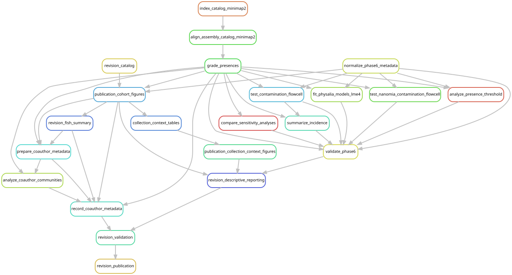

# Current cohort and downstream reporting

The paper compares bacterial, viral and eukaryotic associates across **209
retained specimens**, selected from 213 screened libraries in four studies.
The [library exclusions](../config/excluded_libraries.tsv) remove NA29, NA31,
D666-D10 and T676-SS3 from biological comparisons. The
[contaminant table](../config/contaminant_taxa.tsv) identifies taxa set aside in
the remaining libraries. All 151 *Physalia*, including the ten libraries scored
moderate quality by Church et al., remain in the analysis.

Full evidence tables retain excluded observations and their flags. Sampling
summaries describe the original 213 libraries; detection frequencies and
community comparisons use the retained specimens and taxa. The
[cohort summary](../figures/cohort/summary.json),
[statistical summary](../figures/catalog_review/statistics.json) and
[paper-to-analysis index](../README.md#finding-analyses-from-the-paper) identify
the reported results. A detection is one genome, viral group or broad eukaryotic
group in a specimen; these units do not measure equivalent biological diversity.

## Selected evidence and workflow

[reporting_sources.json](../config/reporting_sources.json) selects the evidence
used by the figure and table producers. The current entry point is
[`workflow/manuscript_revision.smk`](../workflow/manuscript_revision.smk), with
[`config/manuscript_revision.json`](../config/manuscript_revision.json).

| Evidence | Selected source | Scope |
| --- | --- | --- |
| Read coverage | `data/results/post_expansion/2026-10-20/remapping/phase5_mapping/v3/cohort/` | Completed competitive mapping of all 213 libraries |
| Assembly support, grades and statistics | `data/results/manuscript_revision/2026-10-24/phase6_analysis/v3/` | Corrected assembly alignments, exclusions and all three breadth thresholds |
| Competitive SSU evidence | `data/results/post_expansion/2026-10-21/reporting/eukaryote_gate/` | Acceptance by at least 37 read pairs or a non-host assembled SSU; exclusion flags applied during reporting |
| Genome and viral catalogs | [Reviewed manifests](../figures/manuscript_revision/catalog/) | Mapping sequences unchanged; viral groups partitioned into associate and endogenous-candidate classes |
| Specimens and sampling | [Cohort membership](../config/post_expansion_samples.tsv), [publication metadata](../figures/cohort/sample_metadata.tsv) | Original 213 libraries with explicit biological-inclusion flags |
| Tissue, depth and targeted comparisons | [Collection context](../figures/collection_context/), [matched comparisons](../figures/coauthor_metadata/) | Retained specimens; *Physalia* tests use eligible single-flowcell libraries |
| Historical read-handling controls | `data/results/phase6_analysis/v2/sensitivity/` | Original fixed catalogs and subsets |

The workflow realigns assemblies with `minimap2 -x asm5 -c --secondary=no`
(R1), refreshes biological summaries under both exclusion tiers (R2), then
recomputes *Physalia* community and regional tests (R3). It shares
[`phase6_analysis.smk`](../workflow/rules/phase6_analysis.smk),
[`publication_figures.smk`](../workflow/rules/publication_figures.smk) and
[`coauthor_metadata.smk`](../workflow/rules/coauthor_metadata.smk) with the
underlying analyses. Existing read coverage, assemblies and SSU evidence are
required inputs; no read remapping or new genome assembly is scheduled.

## Preview and launch

Run from the repository root on McCleary using the installed Snakemake 7.24
environment described in the [environment guide](workflow/README.md#environment-and-inputs).
Large inputs must be available at the paths selected above. The
[mapping guide](cohort_remapping.md) describes their upstream production.
Use GPFS for temporary files and SLURM for execution.

Preview the publication target without running analyses:

```bash
mkdir -p logs data/results/manuscript_revision/2026-10-24/cache
export XDG_CACHE_HOME="$PWD/data/results/manuscript_revision/2026-10-24/cache"
sbatch --partition=ycga --cpus-per-task=1 --mem=8G --time=00:20:00 \
  --output=logs/manuscript-revision-preview-%j.log \
  --wrap='/gpfs/gibbs/project/dunn/cwd7/conda_envs/snakemake/bin/python -m snakemake revision_publication --snakefile workflow/manuscript_revision.smk --cores 1 --dry-run --printshellcmds'
```

To rebuild assembly support and downstream reporting, submit the catalog index,
the 213-library alignment array, and the reporting job in order:

```bash
revision_index_job=$(sbatch --parsable scripts/manuscript_revision/batch_assembly.sh)
revision_alignment_job=$(sbatch --parsable --dependency=afterok:"$revision_index_job" \
  --array=0-212%16 scripts/manuscript_revision/batch_assembly.sh)
sbatch --dependency=afterok:"$revision_alignment_job" scripts/manuscript_revision/batch_reporting.sh
```

When assembly support is already current, run only:

```bash
sbatch scripts/manuscript_revision/batch_reporting.sh
```

The reporting launcher requests eight cores and 48 GB, and runs
`revision_cohort`, `revision_statistics` and `revision_publication` in order.
It includes a dry run and records source snapshots and execution status under
`data/results/manuscript_revision/2026-10-24/executions/`. Do not run controllers
that write these outputs concurrently.



The graph uses the same entry point and `revision_publication` target. Generate
or check it with `scripts/update_rulegraphs.py manuscript_revision` and the same
command with `--check`, using the [graph environment](workflow/graph-environment.md).

## Results and related analyses

The [validation report](../figures/manuscript_revision/validation.json) checks
unchanged presence calls across the three thresholds, retained membership,
Metamycoplasmataceae incidence and focal regional statistics. R1 can change
assembly-support labels while leaving read-based presence unchanged. Eukaryotic
assembly support includes both reads-plus-assembly and assembly-only detections;
the two counts are reported separately.

Current small outputs are public under [figures](../figures/README.md) and
[tables](../tables/README.md), with source checksums. The bacterial phylogeny,
[16S comparisons](workflow/cnidarian_16s/README.md), [fish screen](fish_12s_results.md),
[human-read assessment](human_read_screen.md) and
[trematode comparisons](waki_sequence_comparison.md) have their own methods guides.
The v2 host-depletion and read-capping controls retain their original scope.
Sequence-deposit preparation uses separate edited genomes and does not repeat
catalog read mapping.

Large reads, databases and intermediate sequence outputs are stored separately.
Two OA libraries still lack verified public run accessions, and the complete
genome and marker deposit remains pending. A clone provides the small supporting
results but does not supply every input needed for a complete rerun.
