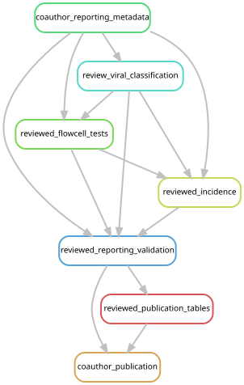

# Current cohort and downstream reporting

The paper reports **213 libraries from four studies**: Church2025 (151),
Ahuja2024 (33), Ahuja2026 (21) and Manko2026 (8). The
[selected cohort](../config/post_expansion_samples.tsv) fixes library membership;
[publication metadata](../figures/cohort/sample_metadata.tsv) supply reviewed host
names and collection information. Original sequence-analysis manifests retain
the identifiers and processing labels used by their source workflows.

The current results contain 567 bacterial detections, one archaeal reference
detection, 624 associate-virus detections and 64 nonredundant eukaryotic detections.
See the [generated cohort summary](../figures/cohort/summary.json),
[domain summary](../figures/overview/domain_summary.tsv) and
[paper-to-analysis index](../README.md#finding-analyses-from-the-paper).
A detection is one genome, viral target or broad eukaryotic group in one specimen;
these units do not measure equivalent biological diversity.

## Selected inputs and completed analyses

[reporting_sources.json](../config/reporting_sources.json) selects the inputs
used by the current figure and table producers. The principal locations are:

| Evidence | Selected source | Interpretation |
| --- | --- | --- |
| Microbial and viral evidence and statistics | `data/results/coauthor_review/2026-10-22/phase6_analysis/v3/` | Reviewed metadata and viral interpretations applied to completed v3 mappings |
| Competitive SSU evidence | `data/results/post_expansion/2026-10-21/reporting/eukaryote_gate/` | All 213 libraries; dated verification reused for 65 sequence-identical assembled queries |
| Mapping catalogs | [Reviewed manifests](../figures/coauthor_review/catalog/) | 478 microbial targets plus 20 decoys; 404 associate-virus groups and 160 endogenous candidates |
| Assembly selection | [Cohort membership](../config/post_expansion_samples.tsv) | All 213 assemblies attempted: 193 reused originals, 12 completion assemblies and eight Bargmannia assemblies |
| Screening summaries | `data/results/post_expansion/2026-10-21/reporting/screens/` | Full trimmed-read screens across all four studies |
| Historical read-handling controls | `data/results/phase6_analysis/v2/sensitivity/` | Original fixed catalogs and subsets; not current v3 comparisons |
| Genome relationships and gene functions | `data/results/mycoplasmatales_phylogeny/` and `data/results/mycoplasmatales_gene_content/` | Retained seven-genome comparison; sequence identities unchanged |

The [mapping guide](cohort_remapping.md) documents the read sources and completed
213-library alignments. Host depletion uses all retained pairs from 151
*Physalia*, ten *N. septata* and two *H. rubrum* libraries. The other 50 libraries
use quality-filtered full reads under the 200-million-raw-pair cap.
The microbial and viral references are separate competitive alignments.

The [viral interpretation guide](viral_reporting_review.md) explains why three
originally associate-labelled targets are now endogenous candidates. All 564
viral targets and their mappings are unchanged. Current host labels include the
[voucher-level Nanomia identifications](sample_metadata.md#nanomia-identifications).
There are 144 single-physical-flowcell libraries, including 122 *Physalia*,
for flowcell-based inference; all libraries remain in descriptive summaries.

## Run from completed evidence

Use Snakemake 7.24.0 and the
[environment and input instructions](workflow/README.md#environment-and-inputs).
From the repository root, the bounded reviewed-reporting entry point rebuilds
metadata, interpretation, flowcell summaries and publication outputs without
reading FASTQs or rerunning assembly or read mapping:

```bash
export XDG_CACHE_HOME=/tmp/siph-snakemake-cache
snakemake -s workflow/coauthor_reporting.smk coauthor_publication --cores 2 --dry-run
snakemake -s workflow/coauthor_reporting.smk coauthor_publication --cores 2
```



Missing completed inputs cause an error. The workflow checks unchanged mapping
measurements and evidence grades; it reruns host-stratified flowcell tests at all
three breadth thresholds and reuses validated *Physalia* regional tests only when
their metadata and bacterial evidence are unchanged. Producing records retain
input, output and source-code identities.

Additional bounded reports have their own launch instructions:

- [Matched host/region and tissue/depth comparisons](coauthor_metadata_analysis.md).
- [Human-read report](human_read_screen.md), [human/C. acnes comparison](human_cutibacterium.md)
  and [C. acnes omission sensitivity](cutibacterium_sensitivity.md).
- [Bacterial tree and function figures](../figures/mycoplasmatales/README.md).
- [Supporting-data export and verification](../tables/README.md).

## Reconstruct upstream reporting products

With completed cohort mappings but no reviewed-reporting products, use this
order. The expanded publication target consumes reviewed catalogs and grades;
it cannot create those inputs itself.

1. Build the initial expanded statistics and graded eukaryotic evidence:

   ```bash
   snakemake -s workflow/expanded_reporting.smk expanded_statistics expanded_eukaryotes --cores 1 --dry-run
   mkdir -p logs
   sbatch scripts/expanded_reporting_local.sbatch expanded_statistics expanded_eukaryotes
   ```

2. After those jobs finish successfully, prepare and validate the reviewed
   catalogs, metadata, grades and flowcell tests:

   ```bash
   snakemake -s workflow/coauthor_reporting.smk reviewed_reporting_validation --cores 2 --dry-run
   snakemake -s workflow/coauthor_reporting.smk reviewed_reporting_validation --cores 2
   ```

3. Build the remaining expanded screening, figure and reporting prerequisites:

   ```bash
   snakemake -s workflow/expanded_reporting.smk expanded_publication --cores 1 --dry-run
   sbatch scripts/expanded_reporting_local.sbatch expanded_publication
   ```

4. After completion, run `coauthor_publication` with the preview and execution
   commands above, then the separate matched-comparison and human-read reports.

The cluster launcher requests 32 cores, 128 GB and 12 hours. It reuses completed
products and records execution, source and configuration. Do not run overlapping
controllers for the same outputs.


Generate or check these graphs with `scripts/update_rulegraphs.py
coauthor_reporting expanded_publication` and the same command with `--check`.
The [execution record](../dev_docs/expanded-cohort-reporting.md) preserves the
completed upstream runs and recovery history.

## Retained scope and limitations

The v2 host-depletion/full-read and capped/uncapped comparisons retain their
original catalogs and fixed subsets. They are not relabelled as v3 controls.
All seven focal Metamycoplasmataceae genomes have unchanged source and sequence
hashes, so their phylogeny, gene-function annotations and earlier cnidarian
comparisons remain valid. The additional *Tyloplasma* genome lies outside that
family comparison. The eight source assemblies for the
[Waki trematode comparison](waki_sequence_comparison.md) also remain unchanged.

The competitive SSU workflow retains the locked 37-pair read threshold and uses
cache-only verification of the 65 assembled non-host queries. A novel query fails
before a new network request. Formalin-preserved *Bargmannia elongata* T676-SS3
exceeds the predefined background threshold, with 288 insect and 71 plant pairs
at at least 97% identity. Its 86 associate-virus detections are unique to this
specimen. The [background sensitivity table](../figures/expanded_review/background_sensitivity.tsv)
reports counts with that specimen omitted; the flag does not prove the viral
matches are false. Its preservation and extraction differed from other samples.

The [fish 12S survey](fish_12s_results.md) covers all 213 libraries using the same
host-depleted/full-read routes. Its 32 qualifying paired sequences occur in eight
*Physalia* libraries. The separate crustacean pilot is outside the reported work.

Small current outputs are public under [figures](../figures/README.md) and
[tables](../tables/README.md), with source checksums. Large read files, databases
and most intermediate sequence outputs are stored separately. Two OA libraries
still lack verified public run accessions, and a complete public deposit of
reconstructed genomes and markers remains pending. The selected trematode FASTAs
are not that complete deposit. A clone therefore supports inspection of current
results but does not by itself provide every input needed for a complete rerun.
