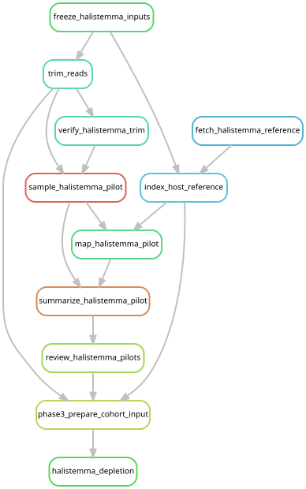

# Halistemma rubrum host depletion

Both depletion mappings and replacement assemblies are complete. Their curated
sequences entered catalog v3, and both libraries completed cohort remapping and
the host-depleted fish screen. [Assembly completion](assembly_completion.md)
uses every retained pair without a minimum read-count cutoff. See
[current reporting](expanded_reporting.md) for downstream results.

Two Ahuja2024 libraries use the
[GCA_987347065.1](https://www.ncbi.nlm.nih.gov/datasets/genome/GCA_987347065.1/)
reference, jhHalRubr1.1. Their stable sample identifiers are unchanged:

| Library | Voucher | Locality | Previously quality-filtered pairs |
| --- | --- | --- | ---: |
| Ahuja2024__CWD12 | YPM-IZ-35038 | Villefranche, Mediterranean | 100,871,052 |
| Ahuja2024__CWD17 | YPM-IZ-35040 | Northwestern Atlantic | 165,797,762 |

Both libraries are below the 200-million-raw-pair limit. Their original
25-million-pair full-read assemblies remain available for comparison. The
selected assemblies use all host-depleted pairs from the complete libraries.
The [fish screen](prey_marker_screen.md#halistemma-host-depleted-libraries)
uses these same retained pairs.

## Workflow

The [depletion workflow](../workflow/halistemma.smk) reuses the established
trimming and BWA depletion rules. Depleted reads are retained under
`data/results/halistemma/2026-10-19/` and passed to the shared MEGAHIT,
barrnap, geNomad, CheckV, MetaBAT2 and CheckM2 rules through
[assembly completion](assembly_completion.md).

1. Download the pinned assembly and check NCBI's compressed-file MD5, accession,
   species, sequence IDs and lengths. Include the nuclear scaffolds and
   mitochondrial sequence listed in the assembly report. Build the BWA index.
2. Regenerate full trimmed reads with the same fastp settings. Check original
   raw-file hashes and read counts against the completed fish-screen records.
3. Draw exactly one million paired reads per library with BBTools seed
   20261019 and map them using the same BWA implementation as full depletion.
   Report mapped reads and the fraction of pairs retained with both mates
   unmapped. Validate paired IDs and BAM/FASTQ accounting.
4. Require at least half the pilot pairs to have a mapped mate in each
   library before automatically proceeding. This is an operational check that
   host removal is useful, not a biological detection threshold. A lower value
   stops the workflow for review; it does not exclude the specimen.
5. Map all trimmed pairs and retain pairs with both mates unmapped, using the
   existing `samtools fastq -f 12` convention. This is the end of the default
   `halistemma_depletion` target. The subsequent assembly workflow attempts both
   libraries without a read-count cutoff, then recovers markers, viral sequences
   and bins and assesses their quality.

Full trimmed and host-depleted reads are retained for the combined analysis.
The launcher archives source, metadata, parameters and execution logs. Reference
size is 4.38 Gb; indexing and mapping request 64 GB RAM. Mapping benchmarks and
pilot summaries provide the evidence for subsequent resource adjustments.

From the repository root, using the established Snakemake environment:

```bash
XDG_CACHE_HOME="$PWD/.cache" snakemake --snakefile workflow/halistemma.smk \
  halistemma_depletion --cores 16 --dry-run --rerun-triggers mtime
mkdir -p logs/halistemma
sbatch scripts/halistemma/launch.sbatch
```

The bounded target `halistemma_pilot` stops after the two pilot mapping reports
and their check. The default `halistemma_depletion` target continues through
complete host depletion. Follow the [assembly launch instructions](assembly_completion.md#run)
afterward. Neither entry point includes pooled catalog construction or cohort-wide
competitive remapping. The old `halistemma` target and its 175,000-pair setting
remain available only to reproduce the original execution; their assemblies
are not selected for current reporting.



## Consistent treatment across host references

Halistemma, Physalia and N. septata use the same BWA depletion implementation
and retain only pairs with both mates unmapped. All retained pairs enter assembly,
microbial and viral catalog mapping, and fish 12S screening. Their assemblies
enter the same marker, genome, viral and contamination checks; the Halistemma
genome is also included in the catalog-wide host-contamination comparisons.

Kraken2, Bracken, sylph and phyloFlash use quality-filtered reads before depletion
for all hosts. Competitive SSU evidence uses those phyloFlash reads plus markers
from each library's selected assembly, including the depleted Halistemma
assemblies. This read-source policy is shared across hosts. The
[host-depletion table](../figures/host_depletion/mapping_stats.tsv) reports both
Halistemma libraries alongside the other 161 host-mapped libraries.
The [processing audit](../dev_docs/halistemma-consistency-audit.md) records the
input-path, count and output checks.

## Combined remapping

The additional MAG/viral quality review and catalog review are complete,
as is the [213-library remapping](cohort_remapping.md).

The reviewed catalog pools the eight new Bargmannia libraries with the original
cohort, using one selected host-depleted assembly per Halistemma library. The
original assemblies remain as comparison baselines. Catalog v3 retains the
MAGSP0026 domain exclusion. Halistemma changes processing for two existing
samples; it does not add samples.

The combined analysis and downstream exports are complete; see
[current reporting](expanded_reporting.md). The manuscript and S1 Appendix use
these expanded-cohort outputs. Neither per-library workflow automatically starts
remapping.
