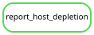

# Host-depletion mapping statistics

The [sample table](../figures/host_depletion/mapping_stats.md)
([TSV](../figures/host_depletion/mapping_stats.tsv)) contains one row per
reference-bearing library: 151 *Physalia*, ten *Nanomia septata*, and two
*Halistemma rubrum*. The *Physalia physalis* reference was used for all five
sampled *Physalia* species; sample species names follow the curated
[metadata](../figures/cohort/sample_metadata.tsv).

The five columns are:

| Column | Definition |
| --- | --- |
| `species` | Current species identification of the sampled siphonophore |
| `sample` | Stable `analysis_sample_id`, also used in analysis filenames |
| `reads_ingested` | Individual quality-filtered reads entering host depletion; twice the input pair count |
| `percent_removed` | `100 × (input_pairs − retained_pairs) / input_pairs`, rounded to four decimal places |
| `reads_remaining` | Individual reads retained after host depletion; twice the retained pair count |

Reads are retained only when both mates are unmapped (`samtools fastq -f 12`).
Thus percent removed includes removal of the unmapped mate of a mapped read.
It is not the percentage of individual reads aligning to the reference.
Input counts exclude reads removed during quality filtering and any prior cap.
All reference-bearing samples appear in this table, including low-yield samples.
All 163 host-depletion jobs are complete; assembly was attempted regardless of
retained-read count.

Counts come from final `phase3_cohort/inputs/{sample}.json` mapping summaries.
The producer checks sample identities, mapping strategy, count bounds, and the
link to the corresponding trimming provenance. It never reads or decompresses
FASTQs. Pilot counts are not used. The current configuration allows no unfinished
mappings. The implementation can identify explicitly configured pending samples,
but none remain in this cohort.

## Rebuild the table

Work from the repository root in the existing Snakemake 7.24.0 environment
(Python 3.11; the reporting script uses only its standard library). On Yale:

```bash
conda activate /gpfs/gibbs/project/dunn/cwd7/conda_envs/snakemake
export XDG_CACHE_HOME="$PWD/.cache"
```

Required inputs are the curated metadata, sample manifests, and the small
mapping/trimming records named in
[the report configuration](../config/host_depletion_report.json).
The [bounded entry point](../workflow/host_depletion_report.smk) includes only
the reporting rule; missing required inputs fail without launching upstream
sequence analyses. It combines records from the original cohort and the separate
Halistemma workflow. Use this entry point rather than the main analysis
Snakefile, which can rebuild upstream sequence analyses.

Dry run:

```bash
snakemake --snakefile workflow/host_depletion_report.smk report_host_depletion \
  --cores 1 --nolock --dry-run
```

Generate the table:

```bash
snakemake --snakefile workflow/host_depletion_report.smk report_host_depletion \
  --cores 1 --nolock --printshellcmds
```

Outputs are the TSV, its readable Markdown counterpart, and
[provenance](../figures/host_depletion/provenance.json), including checksums,
pending samples, and a copy of the producing code/configuration.
Newly completed mapping records become rule inputs on the next invocation.
Add `--config host_depletion_require_complete=true` to require every final
mapping record; this fails while any mapping is incomplete.

To refresh automatically after an already-running final mapping job on Yale,
create `logs/` and submit the small reporting job with that mapping job's
Slurm ID (substitute its actual ID for `MAPPING_JOB_ID`):

```bash
mkdir -p logs
sbatch --dependency=afterok:MAPPING_JOB_ID scripts/host_depletion_report.sbatch
```

This job requires complete mapping records and has no assembly, catalog, or
cohort-remapping steps.


