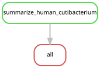

# Cutibacterium and human-compatible reads

This descriptive comparison joins accepted *Cutibacterium acnes* BAC00019
detections to the completed 213-library human screen. The bacterial calls retain
the existing evidence grades and mapping denominators. Human-compatible counts
come from one million raw read pairs per library, selected as equally allocated
prefixes of source FASTQ pairs before host depletion. Their post-QC denominator
is also retained. The workflow reads only completed tables.

The human counts describe these selected prefixes; they do not estimate
whole-library abundance. Prefixes are nonrandom, and equal allocation among
source files does not weight them by their sizes. The separate nt review
examines representative candidate sequences and does not adjust these counts.
A human-compatible match alone is not a species-specific confirmation.

Each specimen retains both the bacterial detection status and human mapping
counts, including true zero human counts. No accepted bacterial detection is
labelled as such, without replacing missing accepted evidence with a measured
zero. Non-detection does not establish absence of either organism. Handling or
reagent contamination can introduce bacterial DNA without detectable human DNA;
co-occurrence also does not establish a common source.

The group summaries compare accepted bacterial detections with specimens lacking
an accepted detection, pooled and within each study. They report library counts,
prefix denominators, and human-compatible count distributions. A separate summary
omits T676-SS3, which was previously flagged by independent background controls.
There is no hypothesis test or data-derived cutoff for elevated human counts.

Sixteen specimens have an accepted *C. acnes* detection. Their median human-compatible
count is 61 pairs per million selected raw pairs (range 0–1,058), compared with
3 (0–53) in the other 197 specimens. Omitting T676-SS3 leaves a median of 50 in
the remaining 15 *C. acnes* specimens. The counts therefore support a cautious
discussion of possible human-associated contamination, while neither the mapping
counts nor co-occurrence identify its source. The automatically generated tables
also retain within-study comparisons.

The separate [community sensitivity](cutibacterium_sensitivity.md) assesses
whether omitting BAC00019 changes the two primary community contrasts.

Run in a compute allocation from the repository root:

```bash
export XDG_CACHE_HOME="$PWD/.cache"
snakemake -s workflow/human_cutibacterium.smk all --cores 1 --dry-run --rerun-triggers mtime
snakemake -s workflow/human_cutibacterium.smk all --cores 1 --rerun-triggers mtime
```

The settings are in [human_cutibacterium.json](../config/human_cutibacterium.json).
The bounded entry point cannot launch sequence screening or mapping. Its outputs
are in [figures/human_cutibacterium](../figures/human_cutibacterium/): a full
specimen comparison, the accepted *C. acnes* specimens, group summaries, JSON and
automatically generated manuscript values. Provenance includes input/output/source
checksums, the actual command and a source snapshot.



Generate or check the diagram with `scripts/update_rulegraphs.py
human_cutibacterium` or the same command with `--check`.
