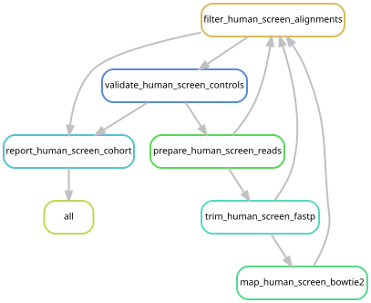
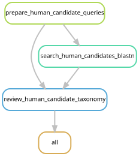

# Human-read assessment

This screen measures human-compatible read pairs in the siphonophore libraries.
It uses the original sequence files before siphonophore depletion. Screening
results do not change any read files, associate catalogs, or existing mappings.

A small audit avoids another full pass through every compressed library. For each
library, up to one million raw pairs are selected as equal-sized prefixes from
its original source files. This covers every source file, but is **not a random
sample of the library**. Percentages describe the selected prefixes; they must
not be extrapolated to whole-library human abundance. Samples with no retained
matches remain unconfirmed for human DNA, rather than being declared human-free.

## Mapping and interpretation

After adapter and quality filtering with fastp 0.23.2, reads of at least 100 bases
are aligned to the locally indexed UCSC hg38 reference with Bowtie2 2.5.1.
End-to-end alignment, a fixed 1,000-base maximum insert size, and exclusion of
mixed and discordant alignments avoid calling short local or rescued single-mate
matches. Both mates must be full-length primary alignments with at least 99%
identity, MAPQ 30, and a proper-pair flag. Sequences with ambiguous bases or
very low base-composition entropy are excluded. Read-pair counts and exact
sequence-pair counts are both reported, along with the number of occupied
one-megabase windows, to identify duplication or concentration at a single locus.

The unfiltered number of concordant hg38 mappings is retained for comparison.
It is not the human-read count. A conserved sequence can map to a human genome
without having come from a human. The stringent count is therefore called
**human-compatible** until broad taxonomic alternatives are reviewed.

Known-origin controls use 10,000 simulated pairs from each of hg38, Physalia,
Nanomia septata and Halistemma rubrum. Reads are 150 bases from 350-base inserts,
with one substitution per mate. The initial control gate requires at least 70%
recovery from the human genome and no retained pairs from the three siphonophore
genomes. This tests the selected stringency on these references; it does not
establish a universal false-positive rate for all possible organisms or a
calibrated sensitivity at different contamination fractions.

For taxonomic review, up to 500 distinct candidate pairs per library are selected
by a deterministic hash order. Their unique mate sequences are searched against
local NCBI nt with megablast, retaining alignments of at least 98% identity over
95% of the read. All reference taxonomic IDs within 5% of the best bit score are reported,
including other organisms, engineered constructs and queries reaching the
100-subject output limit. Searches
with a reached output limit or unknown near-best taxonomy remain unresolved.
Pair-level conclusions require both mates; conflicting mates remain explicit. Close
primate matches are expected for many human reads. A high-quality hg38 match
alone does not distinguish those species. The local nt snapshot is dated 2023;
current siphonophore assemblies and newer sequence deposits may be absent.

## Running the screen

The runs use Python 3.11.0, Snakemake 7.24.0, pysam 0.21.0 and Biopython 1.81
from the existing Snakemake environment. `envs/human-screen.yaml` records the
Python dependencies for reconstruction. The batch scripts load Bowtie2 2.5.1
and fastp 0.23.2 as Yale modules, use samtools 1.9 from the assembly environment,
and load BLAST+ 2.15.0 for confirmation. The observed cluster environments were
used for validation; the new environment specification has not been rebuilt
in isolation. Use these environments and the modules in the batch scripts.
All commands run from the repository root. The pilot includes eight libraries
from the four studies plus the four simulated controls. The full target covers
all 213 libraries with the same one-million-pair prefix audit.

```bash
export XDG_CACHE_HOME="$PWD/.cache"
/gpfs/gibbs/project/dunn/cwd7/conda_envs/snakemake/bin/snakemake pilot \
  --snakefile workflow/human_screen.smk --cores 16 --dry-run
sbatch scripts/human_screen/run.sbatch pilot

# Inspect controls.passed.json and pilot_summary.tsv before scaling.
/gpfs/gibbs/project/dunn/cwd7/conda_envs/snakemake/bin/snakemake all \
  --snakefile workflow/human_screen.smk --cores 16 --dry-run
sbatch scripts/human_screen/run.sbatch all

# Consume completed pilot/cohort candidates; cannot rerun raw-read screening.
sbatch scripts/human_screen/confirm.sbatch pilot
sbatch scripts/human_screen/confirm.sbatch cohort
```

Outputs are under `data/results/human_screen/2026-10-22-v2/`. `pilot_summary.tsv`
and `cohort_summary.tsv` have one row per assessed library and explicit raw and
QC denominators. `controls.tsv` records control performance. Taxonomic review
is in `confirmation/{pilot,cohort}/taxonomic_review.tsv`; this table is a
candidate review, not a revised estimate of all human reads. `samples/` retains
candidate sequences and per-pair mappings for checking. `reads/*.json` records
source paths, prefix sizes, and selected sequence checksums. Temporary FASTQs are removed after their consuming stages succeed; the compact
BAMs of concordant matches are retained for checking mapping/filter decisions. Each submitted job
captures source code, tool versions, job identity and exit status in
`data/results/human_screen/executions/`.

The [Dunn Lab illumina_qc workflow](https://github.com/dunnlab/illumina_qc/blob/main/Snakefile)
provided the starting design: a one-million-pair prefix, human mapping, primary
proper-pair alignments, MAPQ 30 and a bounded insert size. Here, end-to-end
Bowtie2 mapping and explicit identity/length filters on **both** mates address
cross-species matches. The original workflow keeps inserts of 200–1,000 bases;
we retain shorter proper pairs because genuine DNA fragments can be short,
particularly in degraded specimens. Their mates still must meet the complete
alignment criteria. The maximum insert remains 1,000 bases and the value is
fixed across libraries. Outputs count paired fragments, whereas the original
workflow counts passing mate alignments.





The graphs are generated from the `all` targets of `workflow/human_screen.smk`
and `workflow/human_confirmation.smk`.
Regenerate them with `scripts/update_rulegraphs.py human_screen human_confirmation`; the existing
rule-graph freshness check includes this entry. The current validation record
is [here](../dev_docs/human-screen/2026-10-22-validation.md).


The `report` target of `workflow/human_confirmation.smk` stages aggregate tables,
values and provenance in `figures/human_screen/`. It requires the complete
cohort audit and completed confirmation for the chosen scope, and checks the
successful exit status of the supplied execution IDs. It publishes no candidate
sequences, read identifiers or human-genome coordinates. The completed cohort
report was generated with:

```bash
snakemake report --snakefile workflow/human_confirmation.smk --cores 1 \
  --config scope=cohort execution_ids=13732419,13733275,13734795,13734768,13735568
```

`scope=cohort` requires the completed candidate review for every library.
For future validation, `scope=pilot` can instead stage an explicitly labelled
eight-library confirmation subset alongside the completed cohort mapping table.

The local BLAST installation lacks the binary taxonomy-name lookup database.
Taxonomic IDs are present in its hits; the review resolves readable scientific
names from the shared `names.dmp` file. Missing names do not become evidence for
human specificity, and unknown taxonomic IDs remain unresolved.
