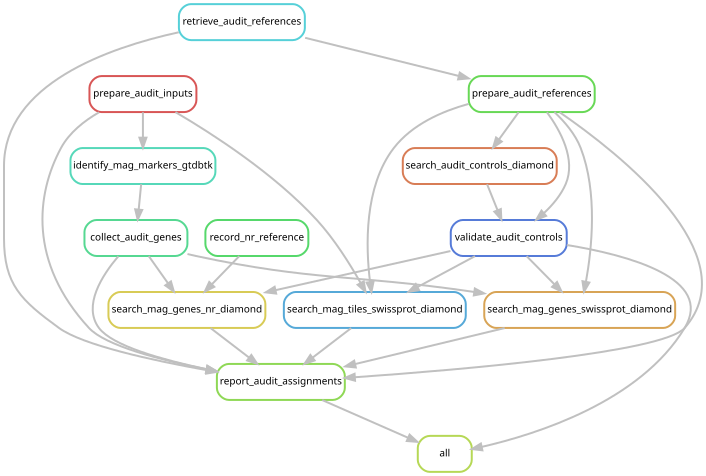

# Reviewing the identity of MAGSP0026

The completed audit identifies MAGSP0026 as a Perkinsela-related eukaryotic bin.
See [the completed review and correction](../dev_docs/mag-domain-audit/run.md)
and [reviewed catalog tables](../figures/catalog_review/). Original sequence and
mapping products remain preserved; the exclusion changes prokaryotic reporting.


An archaeal specialist reported eukaryotic genes in MAGSP0026. This analysis
tests its domain assignment and those of the three bins clustered with it.
It produces review evidence without changing the frozen catalogs or manuscript.

## Inputs and methods

`config/mag_domain_audit.json` identifies all four original bin FASTAs by
absolute path and SHA-256. MAGSP0026 is the representative of
`Church2025__YPM-IZ-110469__bin.2`; the other bins are from TMAG-K5632,
YPM-IZ-110785 and YPM-IZ-111208. Assemblies and reads are not regenerated.

GTDB-Tk 2.4.1 `identify`, using the same r220 data as the original placement,
recovers Prodigal genes and marker matches. All intermediate files are retained.
This step does not assign taxonomy. All predicted proteins are compared with
Swiss-Prot and the existing local NCBI nr database using DIAMOND 2.2.0
`blastp --very-sensitive --evalue 1e-5 --top 10 --max-hsps 1`.

To check evidence without depending on Prodigal gene predictions, overlapping
1,000-base windows (500-base step; final windows shorter than 150 bases omitted)
are searched against Swiss-Prot with `blastx` and the same sensitivity settings.
These windows are diagnostic queries, not independent genes or abundance units.

Swiss-Prot is retrieved with its release metadata (2026_03 at initial setup),
along with current NCBI taxonomy. Downloads are hashed and retained. The local
nr database was built in November 2023 and is hashed before use; its older
coverage limits species-level interpretation. Swiss-Prot taxonomy comes from
explicit OX taxids. The existing nr index has no taxonomy mapping, so organism
names in hit titles are matched to NCBI taxonomy. Missing and ambiguous taxonomy
remains visible rather than being guessed from genus names.

Summaries retain alignments of at least 50 amino acids with E ≤ 1e-5 and compare
all qualifying hits within 5% of the best bit score. Cross-domain near ties
remain ambiguous; a near-best hit lacking resolved taxonomy prevents a confident
domain assignment. All raw hits are retained. No hit is not evidence of absence.
These are screening assignments, not a substitute for marker phylogenies when
the evidence conflicts or for species identification from isolated best hits.

Five known reference proteins per domain are searched before any production
DIAMOND search. Every control must recover its full-length exact reference;
none may be assigned to a wrong domain, and each domain must have at least one
unambiguous control. This checks sequence and taxonomy handling, not sensitivity
to divergent genes. Unit tests cover cross-domain ties, unknown taxonomy, short
alignments and lineage traversal.

## Run and inspect

From the isolated `mag-domain-audit` worktree:

```bash
export XDG_CACHE_HOME="$PWD/.cache"
/gpfs/gibbs/project/dunn/cwd7/conda_envs/snakemake/bin/snakemake all \
  --snakefile workflow/mag_domain_audit.smk --configfile config/mag_domain_audit.json \
  --cores 16 --resources mem_mb=60000 --dry-run
sbatch scripts/mag_domain_audit/batch.sh
```

The batch job requests 16 CPUs, 64 GB and 24 hours on YCGA, where these sequence
data and databases reside. It executes a preserved source snapshot, records
installed Conda packages, and writes execution status and output checksums.

Outputs are under `data/results/mag_domain_audit/2026-10-18/` in the original
analysis repository. `review/genes_swissprot.tsv` and `review/genes_nr.tsv`
report every predicted protein, including unmatched queries. Their
`.counts.tsv`, `.contigs.tsv` and `.archaeal_markers.tsv` companions summarize
domain evidence and connect it to the GTDB marker hits. `review/tiles_swissprot.tsv`
reports translated windows. Known-answer checks are in `controls/`; execution
records and source snapshots are in `executions/<SLURM job ID>/`.



The graph is generated from the same entry point and target:

```bash
SNAKEMAKE=/gpfs/gibbs/project/dunn/cwd7/conda_envs/snakemake/bin/snakemake \
  python scripts/update_rulegraphs.py mag_domain_audit
# Add --check to verify freshness without changing files.
```

## Decision to follow

Review agreement across genes and contigs in each bin, the translated-window
check, and the taxonomic support for GTDB marker hits. A consistent eukaryotic
signal supports reassignment; spatially separated bacterial, archaeal and
eukaryotic signals require bin-level investigation. Keep unresolved evidence
explicit. Any catalog correction and manuscript changes follow this assessment.
