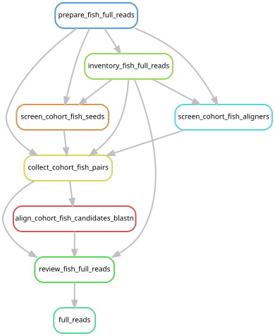
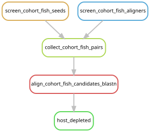

# Fish 12S screen

The active survey searches fish 12S across host groups, including *Physalia*,
*Nanomia* and *Erenna*. Host identity determines read preparation, not which
libraries can contain fish evidence. Crustacean COI work was paused on 2026-10-18
and preserved on branch `crustacean-coi-screen`; it is not a dependency of this
fish workflow.

## Revised pilot, 2026-10-17

| Screen | Libraries | Read input | Total pairs |
| --- | --- | --- | ---: |
| Fish 12S | Five previously selected *Physalia*: WAM-Z97917, YPM-IZ-110906, YPM-IZ-110907, YPM-IZ-111156, YPM-IZ-111158 | All retained host-depleted pairs | 10,180,068 |

The [pilot manifest](../config/fish_12s_host_depleted.tsv) is generated from existing
metadata and validated retained file paths by
[`scripts/prey_marker_inputs.py`](../scripts/prey_marker_inputs.py). Regeneration
of this manifest does not run sequence analyses. No additional pair cap or
subsampling is applied to the host-depleted files.

The existing host-depleted FASTQs are present for all 151 *Physalia* and ten
*N. septata* libraries. They follow quality filtering and the original cap of
200 million raw pairs per library. Both mates were required to be unmapped to
the host. The files are in `data/results/phase3_cohort/inputs/`; per-library JSON
files record both the input and retained pair counts.

The earlier raw-lane fish jobs are superseded. Their completed results and
execution records are preserved.

## Expansion and sensitivity

The host-depleted fish cohort is complete. The approved expansion screens all
44 remaining libraries, bringing the survey to all 205 libraries. Review
competitive alignments before treating recruited candidates as fish identifications.
Use all existing host-depleted pairs where available.
For the other 44 libraries, use full quality-filtered inputs under the original
200-million-pair cap rather than the 25-million-pair assembly subset. This is the
recommended starting depth, not a claim that 200 million guarantees detection.

Those full trimmed FASTQs were intentionally deleted after earlier screening
and mapping. The raw reads are retained; full trimmed inputs must be recreated
in the new screening workflow, using the established filtering and seeded cap.
That preparation should not invoke the old assembly, mapping or reporting DAG.

Across these 44 libraries, the inventories contain 12,255,368,962 raw pairs;
7,939,126,078 pairs remain after the proposed cap but before quality filtering.
Twenty-eight libraries exceed 200 million raw pairs. All pairs are used for
libraries below the cap. The cap is sampled across all lanes with BBTools 38.90,
seed 20260829, followed by fastp 0.23.2, using the original trimming implementation
and environment. Input hashes, lane order, settings and retained counts are
checked against the previous preparation. The old 25-million-pair assembly
subsets are not used.

## Full-read fish expansion

The [frozen library manifest](../config/fish_12s_full_reads.tsv) selects the 44
reference-free libraries. The [configuration](../config/fish_12s_full_reads.json)
records the cap, reference paths and output directory. The entry point shares
the four search methods and competitive BLAST rules with the completed
host-depleted screen. It includes no original assembly or microbial analysis rules.

Reference classification uses accession-linked GenBank lineages from the
2026-09-03 RefSeq mitochondrial release, together with annotated MitoFish 12S
records. GenBank sequences are checked against the frozen FASTA; CONTIG-only
records are checked by accession version and length. Reports also give the
overlap of each best alignment with annotated 12S coordinates. Review categories
remain preliminary, and whole-mitochondrial matches can include flanking sequence.

The control check verifies competitive alignments as well as recruitment: four
fish controls must pass, the frog must match a non-fish reference and be rejected,
and random, quality-only and repetitive controls must not be recruited. Each
production task reruns this check, so an old recruitment-only success marker is
insufficient. A two-lane fixture exercises the complete capped and uncapped paths.

```bash
mkdir -p logs/fish_12s
# One-time accession-linked annotation; reuses the frozen search databases.
sbatch scripts/fish_12s/batch_reference_metadata.sh
# After annotation completes, validate the full raw-read path.
sbatch scripts/fish_12s/batch_full_reads_validation.sh
# Inspect and launch after validation succeeds.
snakemake full_reads --snakefile workflow/fish_12s_full_reads.smk \
  --configfile config/fish_12s_full_reads.json --cores 16 --dry-run --rerun-triggers mtime
sbatch --array=0-43%4 scripts/fish_12s/batch_full_reads.sh
```

Each array task handles one library, with at most four libraries in flight.
Outputs are under `data/results/fish_12s/full_reads/2026-10-18/`: `trim/` holds
quality metrics and raw-input provenance, `inputs/` holds prepared-read manifests,
`screen/` and `aligners/` preserve method-specific evidence, `union/` preserves
both mates and competitive alignments, and `review/` contains per-library sample
and candidate tables. Temporary full filtered FASTQs are removed only after all
four filters and paired candidate recovery finish. Execution records and source
snapshots are retained under `data/results/fish_12s/executions/`.



Generate/check this graph with `scripts/update_rulegraphs.py fish_full_reads`
or the same command with `--check`.

Reports must retain the original processed-library count, post-filtering count
and post-depletion count separately. Host-depleted and undepleted pair counts
are different denominators and should not be treated as equal sequencing effort.
Reference coverage, competitive identification, and the number of independent
supporting fragments also affect sensitivity and interpretation.

## All host-depleted libraries

[The cohort manifest](../config/prey_marker_host_depleted.tsv) contains all 161
libraries and 416,741,747 retained pairs. Generate it with
`python scripts/prey_marker_inputs.py --all-host-depleted`; this leaves the pilot
manifests unchanged. The fish screen uses every retained pair. The manifest
also preserves the post-QC, pre-depletion counts as a separate denominator.

The frozen manifest retains its original shared-panel selection labels for
provenance. Its sample membership, read paths, counts and content are unchanged;
those historical labels do not invoke a crustacean analysis.

The fish entry point reuses the five completed *Physalia* pilots and searches
the other 156 libraries with the tested regex, BBDuk, Bowtie2 and SortMeRNA
implementations. It retains both original mates from the union, checks pair
counts/synchronization, and applies the same competitive mitochondrial BLAST
comparison. Recruitment counts remain candidate counts until those alignments
are reviewed. The control test includes a frog candidate that must be excluded
from fish identifications by competitive verification.

```bash
snakemake host_depleted --snakefile workflow/fish_12s_host_depleted.smk \
  --cores 24 --dry-run --rerun-triggers mtime

# After the fish controls have completed and passed:
sbatch scripts/fish_12s/batch_host_depleted.sh
```

Fish outputs are under
`data/results/fish_12s/cohort_host_depleted/2026-10-18/`, with `screen/`,
`aligners/` and `union/` directories. The completed pilots remain in their original
directories. This bounded workflow has no rules for host depletion, assembly,
catalog construction or manuscript analyses. External references and completed
pilots must already exist.

The fish cohort workflow can be tested on the nine existing synthetic pairs:

```bash
sbatch --cpus-per-task=8 --mem=20G --time=00:30:00 \
  scripts/fish_12s/batch_host_depleted.sh config/fish_12s_cohort_validation.json
```

The same workflow and scripts run the test and the cohort; the test configuration
changes the manifest and output root and requests the known-answer checks.
Execution records are retained in `data/results/fish_12s/executions/{SLURM_JOB_ID}/`.
See the [expansion execution notes](../dev_docs/prey-marker-expansion.md) for the
submitted source snapshots and current job identities.



This graph uses the entry point and configuration above. Generate/check it
with `scripts/update_rulegraphs.py fish_host_depleted`.
The existing rule-graph CI check includes it.

## Running the pilot

The [fish guide](fish_12s_screen.md) describes the existing regex, BBDuk,
Bowtie2, SortMeRNA and competitive mitochondrial-reference comparisons.

For the revised fish pilot, reuse the prepared fish reference databases and run:

```bash
mkdir -p logs/fish_12s
sbatch --array=0-4%3 scripts/fish_12s/screen_positive.sbatch \
  config/fish_12s_host_depleted.tsv data/results/fish_12s/host_depleted/2026-10-17
# Replace SCREEN_JOB_ID with the returned array job ID.
sbatch --array=0-4%3 --dependency=aftercorr:SCREEN_JOB_ID \
  scripts/fish_12s/align_positive_candidates.sbatch \
  config/fish_12s_host_depleted.tsv data/results/fish_12s/host_depleted/2026-10-17
sbatch --array=0-4%3 scripts/fish_12s/compare_aligners.sbatch \
  config/fish_12s_host_depleted.tsv data/results/fish_12s/host_depleted_aligners/2026-10-17
```

After both searches finish, `scripts/fish_12s/compare_candidate_ids.py` compares
read-pair identities and exports aligner-only pairs for the same competitive
BLAST verification. Its `--manifest`, `--screen-root`, `--aligner-root` and
`--output` arguments select the completed run directories. The exported
`manifest.tsv` supplies array rows to `align_positive_candidates.sbatch`;
set the array bounds to its number of data rows. This prevents candidates found
only by a sensitive aligner from being omitted from verification.

Use a new dated run directory to repeat the fish pilot; its scripts refuse to
overwrite an existing run. Execution histories are recorded in the
[fish notes](../dev_docs/fish-12s/positive_pilot.md).
