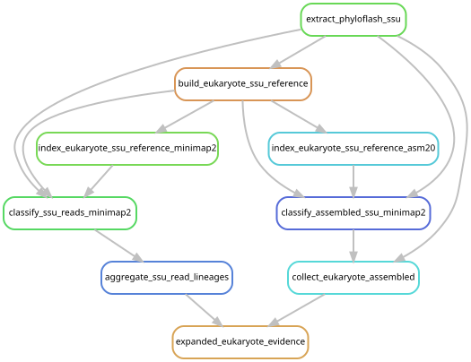

# Distinguish non-host eukaryotic SSU evidence

[Workflow index](../README.md) · [Source rules](../../../workflow/rules/eukaryote_gate.smk)

Use ribosomal small-subunit (SSU) sequences to assess candidate prey, parasites
and other eukaryotes while reducing confusion with the siphonophore host.
Read and assembly evidence are two ways of processing the same sequencing data.

## Inputs and products

Inputs are accepted phyloFlash archives/provenance, SILVA 138.1 sequences,
host SSUs from all 213 libraries, and ribosomal genes from their selected
assemblies. The original 205 extracted SSU read files are reused; eight new
phyloFlash archives provide the added libraries. Classifications use the expanded
competitive host reference.
[config/eukaryote_gate.json](../../../config/eukaryote_gate.json) defines the grades;
[the decision record](../../eukaryote_gate_decisions.md) explains reporting units.
Products in `data/results/post_expansion/2026-10-21/reporting/eukaryote_gate/` include `read_lineages.tsv`,
`assembled_nonhost.{tsv,fasta}`, `ncbi_verification.tsv` and `eukaryote_grades.tsv`.

## Steps and rules

1. `extract_phyloflash_ssu` extracts pairs and assembled SSUs;
   `build_eukaryote_ssu_reference` combines SILVA with host sequences.
2. `index_eukaryote_ssu_reference_minimap2` creates the short-read index;
   `classify_ssu_reads_minimap2` assigns pairs to the lowest common ancestor of
   near-tied hits. `aggregate_ssu_read_lineages` pools all libraries and
   `eukaryote_evidence` requests this read-only branch.
3. `index_eukaryote_ssu_reference_asm20` creates the long-sequence index;
   `classify_assembled_ssu_minimap2` classifies phyloFlash assemblies and extracted
   Phase 3 18S genes; `collect_eukaryote_assembled` collects non-host sequences.
4. `verify_eukaryotes_ncbi` retains dated verification for identical sequences.
   All 65 current queries match the cache. The current entry point requires
   cache-only mode and fails before a network request if a new query appears.
   Cached records retain their actual query dates and request IDs.
5. `grade_eukaryotes` combines the evidence; `validate_eukaryote_gate` checks it;
   `eukaryote_gate` requests the complete graded branch.

## Interpretation and graph boundary

`eukaryote_evidence` alone does not request final grades. Both entry points appear
below to make that distinction visible. Accepted phyloFlash archives are resolved
through checksum-checked provenance passed as a parameter; the graph therefore
starts that branch at extraction rather than at the original screen.

Reported groups use conservative taxonomic and ecological assignments. Repeated
markers do not count as independent species, and molecular detection does not
establish diet, infection or a living associate on its own. The targeted Waki
marker comparison is a separate analysis outside this rule file; see
[its methods and reproduction record](../../waki_sequence_comparison.md).

## Preview, launch and rule graph

Run from the repository root after the [environment setup](../README.md#environment-and-inputs).
The local evidence target includes competitive read and assembled-SSU
classification but excludes NCBI queries and final grades:

```bash
snakemake -s workflow/expanded_reporting.smk expanded_eukaryote_evidence --cores 1 --dry-run
sbatch scripts/expanded_reporting_local.sbatch expanded_eukaryote_evidence
```

The local launcher runs Snakemake within one 32-core, 128-GB Slurm allocation,
avoiding hundreds of scheduler submissions. Do not overlap it with an active
controller using the same outputs. The `expanded_eukaryotes` target additionally
requests verification, grades and validation; consult
[current status](../../expanded_reporting.md) for the completion state before submitting it. Current verification requires
no external queries.



Generated from `workflow/expanded_reporting.smk`,
`config/expanded_reporting.json` and target `expanded_eukaryote_evidence`.
The [complete branch graph](../graphs/expanded_eukaryotes.svg) also shows
verification and final grading; the [original graph](../graphs/eukaryotes.svg)
retains the earlier 205-library execution scope.

```bash
./scripts/update_rulegraphs.py expanded_eukaryote_evidence expanded_eukaryotes
./scripts/update_rulegraphs.py expanded_eukaryote_evidence expanded_eukaryotes --check
```
