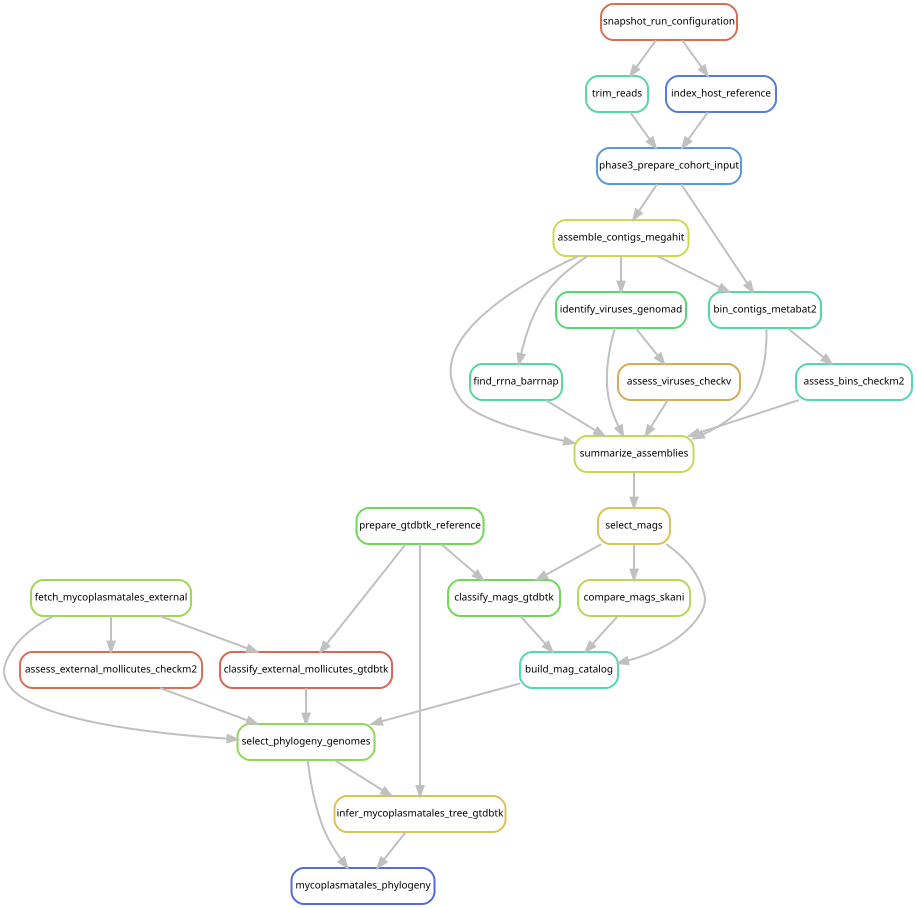

# Place recovered Mycoplasmatales in a genome tree

[Workflow index](../README.md) · [Input-preparation rules](../../../workflow/rules/mycoplasmatales_phylogeny.smk) · [IQ-TREE execution](../../mycoplasmatales_iqtree.md)

Compare the recovered Mycoplasmatales genomes with public relatives and infer a
phylogeny with IQ-TREE 3 from 120 conserved bacterial marker proteins (bac120). This provides
evolutionary context for the focal bacterial lineages.

The retained tree contains seven focal siphonophore Metamycoplasmataceae genomes.
Their source and sequence hashes are unchanged in catalog v3, so the expanded
cohort reuses the prepared alignment. The newly retained Tyloplasma-related genome
`MAGSP0033` belongs to Hepatoplasmataceae and is outside this focal comparison;
the tree does not place it. See the [reporting scope](../../expanded_reporting.md).

## Inputs and products

Inputs are the recovered MAG catalog/representatives, GTDB r220 and the frozen
[external-genome table](../../../config/mycoplasmatales_external.tsv).
[config/mycoplasmatales_phylogeny.json](../../../config/mycoplasmatales_phylogeny.json)
sets taxonomic selection, completeness and outgroup criteria.
Outputs in `data/results/mycoplasmatales_phylogeny/` include external-genome
retrieval/quality records, `tree_genomes/`, `tree_labels.tsv`,
`mycoplasmatales.bac120.msa.fasta.gz` and the historical `.decorated.tree` file.
The reported IQ-TREE output is
`data/results/mycoplasmatales_phylogeny/iqtree3/2026-10-25/bac120.treefile`;
the same directory holds its report, five run trees, support outputs and
input/execution records. ModelFinder selected LG+F+I+R10. Node support is
SH-aLRT / ultrafast bootstrap, both in percent.

## Steps and rules

1. `fetch_mycoplasmatales_external` retrieves the fixed NCBI genome list and checks
   download identities.
2. `assess_external_mollicutes_checkm2` estimates genome quality;
   `classify_external_mollicutes_gtdbtk` checks GTDB taxonomy.
3. `select_phylogeny_genomes` selects eligible genomes and labels while preserving
   their source and recovered species-cluster identities.
4. `infer_mycoplasmatales_tree_gtdbtk` prepares the de novo bac120 alignment
   and historical baseline tree with the configured GTDB taxon filter and outgroup.
5. `mycoplasmatales_phylogeny` requests these prepared inputs and labels.
6. [`scripts/revision_iqtree.sbatch`](../../../scripts/revision_iqtree.sbatch)
   infers the reported IQ-TREE phylogeny from that alignment. It performs five
   independent searches, each with 1,000 SH-aLRT and 1,000 NNI-refined ultrafast
   bootstrap replicates, and retains the best-scoring run. This standalone
   step is not represented in the Snakemake graph below.

## Interpretation and handoff

The tree places genomes; a short 16S marker match in another dataset supplies a
different kind of evidence. Host metadata identify the source of a public genome,
not proof of a restricted host range. See
[the comparative-context report](../../mycoplasmatales_context_results.md).

[Publication plotting](../publication_figures/README.md) uses the completed
IQ-TREE tree. The graph includes recovered-genome construction and the GTDB
input preparation; it does not describe the final standalone IQ-TREE execution.

## Preview, launch and rule graph

Run from the repository root after the [shared environment setup](../README.md#environment-and-inputs).
The preview evaluates the input-preparation dependencies without executing
analysis jobs. The launch command submits that preparation scope through the
existing cluster controller.
This scope can build missing upstream products; it is not restricted to this one rule file.

```bash
# Preview only.
snakemake mycoplasmatales_phylogeny \
  --snakefile Snakefile --configfile config/config.yaml \
  --cores 1 --dry-run --rerun-triggers mtime

# Execute this scope on the cluster (not needed to view or regenerate graphs).
bash scripts/submit_workflow.sh mycoplasmatales_phylogeny config/config.yaml
```

Once the existing alignment and labels are available, the final inference uses:

```bash
sbatch scripts/revision_iqtree.sbatch
```

The accepted run is already complete; another launch is unnecessary for
plotting or manuscript builds. See the [IQ-TREE guide](../../mycoplasmatales_iqtree.md)
for software, resources, input checks and checkpoint behavior.



Generated by Snakemake from `Snakefile`, `config/config.yaml`, targets `mycoplasmatales_phylogeny`.
All declared upstream rules needed by these targets are included.
Repeated jobs collapse to one node per rule; arrows point from producers to consumers.
See [graph limits and freshness checks](../README.md#regenerate-and-check-the-graphs).

```bash
# Documentation only; never executes analysis rules.
./scripts/update_rulegraphs.py phylogeny
./scripts/update_rulegraphs.py phylogeny --check
```
