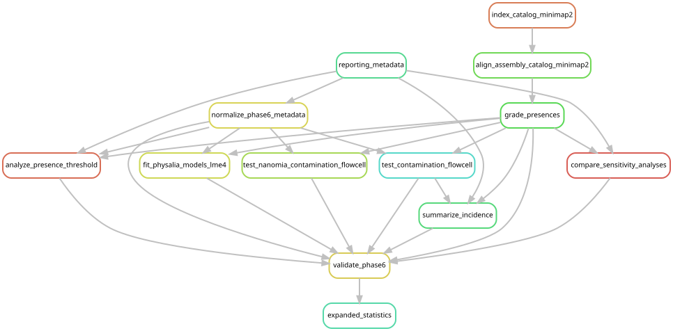

# Grade detections and test distributions and sensitivity

[Workflow index](../README.md) · [Source rules](../../../workflow/rules/phase6_analysis.smk)

Combine competitive read mapping with assembly evidence, summarize associate
incidence, test geographic/batch patterns, and assess sensitivity to thresholds
and read handling. A detection grade describes sequence evidence, not symbiosis,
infection, viability or host specificity.

## Inputs and products

Current inputs are the completed 213-library v3 coverage tables, reviewed v3
catalogs, selected assemblies and reporting manifest with curated host names.
[expanded_reporting.json](../../../config/expanded_reporting.json) selects these
paths without changing the original sequence inputs.
[phase5_presence.json](../../../config/phase5_presence.json) specifies unchanged
presence thresholds; [phase6_analysis.json](../../../config/phase6_analysis.json)
and [the analysis plan](../../phase6_analysis_plan.md) define inference.
Products in `data/results/post_expansion/2026-10-21/reporting/phase6_analysis/v3/`
include `grades/`, `primary/`, `assembly_support/` and `sensitivity/`.
The version annotation in the presence-policy file does not select output paths.

## Steps and rules

1. `index_catalog_minimap2` and `align_assembly_catalog_minimap2` measure
   same-library contig support for catalog genomes.
2. Historical v2 control mappings were produced by `trim_reads_uncapped`,
   `map_reads_sensitivity_bwa` and `summarize_sensitivity_coverage_coverm`.
   Those read-handling comparisons retain their original catalog and subsets.
   The current bounded target does not repeat or relabel them as v3 controls.
3. `grade_presences` applies the locked grades; `normalize_phase6_metadata` records
   physical flowcells. `test_contamination_flowcell` and
   `test_nanomia_contamination_flowcell` assess concentration by sequencing batch.
4. `summarize_incidence` produces bacterial/viral summaries and phage-host links.
   `fit_physalia_models_lme4` fits the specified models and the approved
   within-flowcell region permutation test.
5. `analyze_presence_threshold` repeats inference at 5% and 20% breadth;
   `compare_sensitivity_analyses` summarizes threshold and study-nomination
   sensitivity for v3. Read-handling comparisons are disabled in this scope.
6. `validate_phase6` checks outputs; `expanded_statistics` requests the current downstream branches.

## Interpretation and handoff

Bacterial validation requires at least 10% breadth and 100 mapped reads; assembly
support raises the evidence grade. High-confidence support can come from the
source MAG or at least 10,000 aligned catalog bases at 95% identity. Viral presence
uses at least 75% breadth, with source-assembly support tracked separately.

Descriptive summaries retain all 213 libraries. Flowcell inference uses the
single-physical-flowcell subset, including 122 Physalia libraries. Failed or
singular mixed-model fits are not valid significant results; the approved
permutation analysis and its stated limits are the inferential evidence.
Host-handling controls map to a fixed catalog and do not measure discovery of
microbes absent from it. The original root-workflow `phase6_analysis` target includes control mappings;
the bounded `expanded_statistics` target consumes completed cohort coverage and
assemblies and cannot reopen full-library read processing. [Publication exports](../publication_figures/README.md)
consume the graded and summarized results.

## Preview, launch and rule graph

Run from the repository root after the [environment setup](../README.md#environment-and-inputs).
Check [execution status](../../expanded_reporting.md) before submitting; avoid overlapping controllers.

```bash
snakemake -s workflow/expanded_reporting.smk expanded_statistics --cores 1 --dry-run
sbatch scripts/expanded_reporting.sbatch expanded_statistics
```



The graph is generated from `workflow/expanded_reporting.smk`,
`config/expanded_reporting.json` and target `expanded_statistics`.
It includes assembly-to-catalog support alignments and downstream statistics;
completed coverage and catalog inputs have no producer in this entry point.

```bash
./scripts/update_rulegraphs.py expanded_statistics
./scripts/update_rulegraphs.py expanded_statistics --check
```

The [original analysis graph](../graphs/analysis.svg) remains a historical view
of the v2 workflow, including read-handling controls and upstream dependencies.
